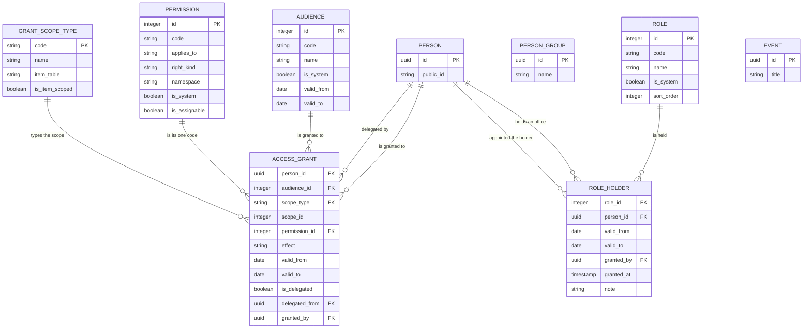
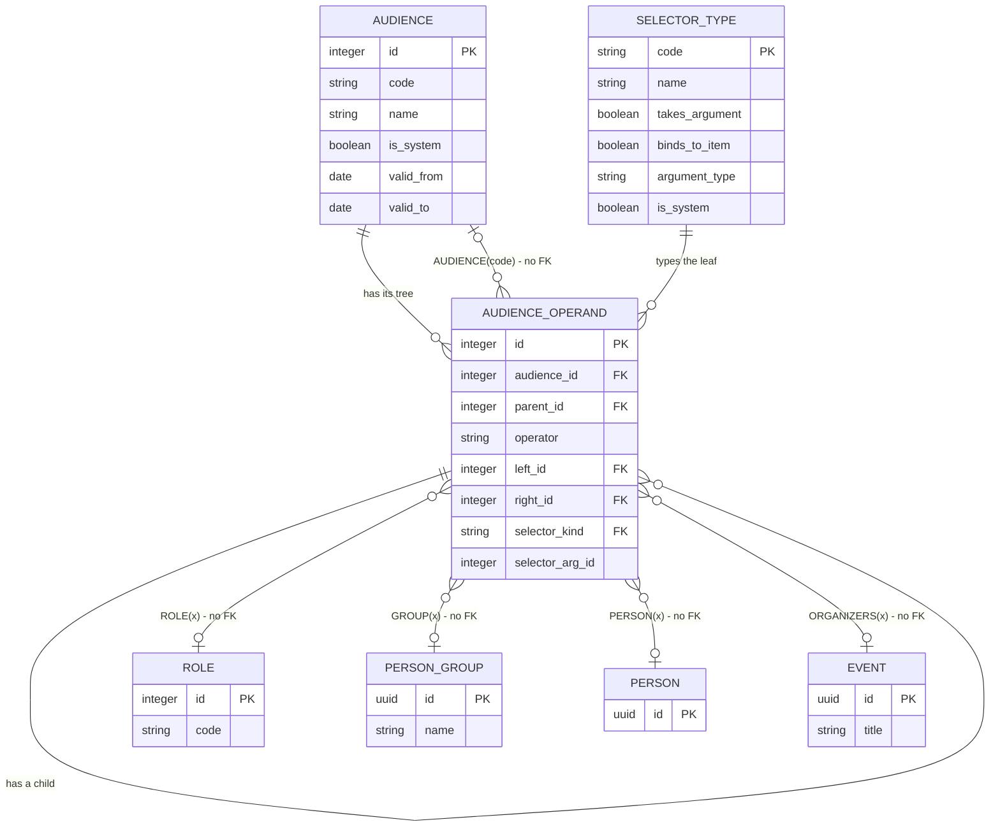

# Appendix — ERD: authorization

The authorization model as one diagram, the tables behind it, and the expression tree an audience is stored as.

**Section numbers are shared across the three parts** and never renumbered, because other pages cite them by number and their anchors are built from them: [erd.md](erd.md) holds §1–§4, the diagrams of the people — identity and attributes, the unit's groups and offices, membership, guardianship; [erd-a-authorization.md](erd-a-authorization.md) holds §5–§5b, the whole authorization answer, its tables and the audience expression tree; [erd-b-inventory.md](erd-b-inventory.md) holds §6–§8, the temporal pattern, the table inventory and the foreign key summary.

---

## 5. Authorization — the whole answer in one diagram

```
                     ┌──────────────────────────────┐
                     │          permission          │   'membership.request.approve'
                     │   code · resource · action   │   'event.answer.view'
                     │   applies_to ∈ unit |        │   where a code may be granted at all,
                     │              unit_and_item   │   checked when the GRANT IS SAVED (D-099)
                     │   right_kind ∈ read | write  │   ONE customer: the guardianship channel
                     └──────────────┬───────────────┘   (D-074, given the column by D-099)
                                    │
     one check asks for ONE code. There is no wildcard except 'system.admin' (D-068):
     "can do everything about events" is an OFFICE some grants name, one code per grant.
                                    │
                                    ▼
 ╔═══════════════════════════════════════════════════════════════╗
 ║                         access_grant                          ║  THE ONLY TABLE THAT
 ║  person_id   ─┐  exactly ONE names the grantee: both is       ║  GRANTS (D-005). A grant at
 ║  audience_id ─┘  ambiguous, neither is meaningless            ║  the unit reaches EVERY item
 ║  scope_type ────►  grant_scope_type                           ║  of every type; a grant on
 ║               unit | event | person_group | role | document   ║  one item reaches that item
 ║  scope_id  ⇒ (polymorphic, NO foreign key; ABSENT exactly at  ║  and nothing else (D-099).
 ║               'unit' — that absence IS "the unit is a scope,  ║  There is no middle tier
 ║               not a row")                                     ║  left for anything to
 ║  permission_id ───► permission   (one code, never a bundle)   ║  inherit down.
 ║  effect ∈ allow | deny      DENY IS ABSOLUTE: checked first,  ║
 ║                             scope-independent, beats every    ║  the ladder — revoked 0,
 ║                             allow, no tie-break of any kind   ║  view 10 … admin 40 — is
 ║  valid_from / valid_to [T] · granted_by · revoked_by/_at      ║  deleted, with its rank
 ║  is_delegated · delegated_from  (a delegation must expire)    ║  rule and its locality (D-099)
 ╚═══════════════════════════════════════════════════════════════╝
        ▲ aimed at by id                        ▲ named by code from a leaf (D-103)
        │
   ┌──────────────────────┐                 ┌───────────────────────┐
   │         role         │  an office, and │       audience        │  an EXPRESSION over
   │ code · name ·        │  it confers     │ name · code? ·        │  named sets, stored as a
   │ description ·        │  NOTHING        │ valid_from/[to] [T]   │  tree (D-101) — not a rule
   │ is_system ·          │  by itself:     │ (no kind · no         │  XOR a list XOR an
   │ sort_order           │  the codes an   │  resolver_key · no    │  inclusion (D-091, as
   │ NO period (D-053)    │  office carries │  include_depth_limit  │  amended by D-103; its
   │ NO scope, no         │  are the live   │  · no depth limit)    │  list arm closed by D-105)
   │ requires_member-     │  grants whose   └───────────┬───────────┘
   │ ship (D-100)         │  audience names ├───────────┴──────────────────────────┐
   └──────────┬───────────┘  ROLE(x)        ▼                                      │
              │ dated holders     ┌─────────────────────┐                          │
              ▼                   │  audience_operand   │  hand-written people     │  the audience's
   ┌────────────────────────────┐ │ one row = ONE NODE: │  are PERSON(a) +         │  expression is
   │ person · role ·            │ │ operator + left_id  │  PERSON(b) leaves in     │  evaluated live
   │ valid_from · valid_to ·    │ │  ...or... ONE LEAF: │  the tree — LIST and     │  at the resolver
   │ granted_by · note          │ │ selector_kind +     │  its table are deleted   │  (D-101)
   │ NO scope columns at all:   │ │ selector_arg_id ⇒   │  (D-105), and so are     │
   │ a role is held at the unit │ │ (NO FK — see below) │  their per-person dates  │
   └────────────────────────────┘ └──────────┬──────────┘                          │
                                             │ every leaf is typed by              │
                                             ▼                                     │
                                  ┌─────────────────────────────┐                  │
                                  │        selector_type        │  SEEDED and      │
                                  │ code (a RESERVED word) ·    │  organization-   │
                                  │ takes_argument ·            │  read-only: the  │
                                  │ binds_to_item ·             │  language is data│
                                  │ argument_type · is_system   │  (D-101), not    │
                                  └─────────────────────────────┘  extensible at   │
                                                                   runtime         │
                                                                                   │
   A BOUND operand — the argument-less `PLACED`, `ORGANIZERS`, `CONFIRMED`,        │
   `ATTENDED`, `ON_WAITLIST` — means "relative to the item being                   │
   checked". Legal only on an item-scope grant whose type matches `argument_type`  │
   (`PLACED` on a group grant is refused, `ORGANIZERS` on a unit grant is          │
   refused), and the seeded `event.answer.view` → `ORGANIZERS` is therefore a      │
   TEMPLATE instantiated beside each event row, not one row for every event        │
   (D-102). `OLDER(n)` and `YOUNGER(n)` bind to no item and point at no row:       │
   their argument is an integer — the registry's first non-reference — so          │
   `selector_arg_id` holds a number with nothing behind it: no edge to draw,       │
   nothing for a merge to repoint, nothing for a cascade to find, and the two      │
   reference-less polymorphic keys stay exactly two. Thirteen seeded rows:         │
   five argument tables, one integer, and the operators are still `+ - *`.         │
   `PRESENT(<event>)` is not seeded, and the reason is a consequence: a tick box   │
   on a check-in screen would revoke a leader's access to their own camp when      │
   somebody forgets to tick it. `WHITELISTED` is not seeded either, for want of    │
   any state to evaluate (F-20). Neither is kept out by the language — nothing     │
   in it would refuse either name — both are kept out by what they would do.       │
   `GUARDIANS` is not seeded either, in either form: a guardian holds a level over │
   a child, not a permission set, so an audience aimed at them offers one code at  │
   a time what the guardianship channel grants outright (D-113).                   │
                                                                                   │
   can(person, permission, scope_type, scope_id, at, about_whom) ── ONE resolver ─ ┘
   ──────────────────────────────────────────────────────────────────────────────
    0  explicit DENY ── absolute and scope-independent. A deny at the unit reaches every
       item of every type; a personal deny beats an audience allow, because this step has
       already returned (D-013 — whose `revoked` LEVEL is now an EFFECT on a grant row).
    1  a live ALLOW at the unit ── reaches every item of every type: after D-097 there is
       no tier between the unit and an item, and after D-102 no owner to ask.
    2  a live ALLOW on this exact item ── exact scope type and id. Nothing precedes it:
       `can_event()` and the unit-authority rule are deleted (D-102).
    3  OWNERSHIP ── the checked person is the actor. Their own row, their own data.
    4  GUARDIANSHIP ── entered by SHAPE (the subject is not the actor), never by a code's
       name; answers with an ALLOW only, when `right_level` covers `permission.right_kind`
       — none covers nothing, view covers `read`, write covers both (D-074, D-079, D-099).
    5  default DENY.
   The allow steps are ALTERNATIVES producing one boolean: their order decides which channel
   the audit names, never what the answer is. **Locality is deleted** — it only ever ordered
   allows against each other, and a boolean has nothing to order (D-099, deleting the second
   half of D-032; the first half is step 0 and is now its entire content).
```

**Key points:**

- **One table grants.** `access_grant` is the only place authority is written, plus the one
  table over a single person, `guardianship_permission` (§4, step 4 above). `role_holder`,
  `person_group_member` and every operand of an audience decide only **whom a grant reaches** —
  being in a set is worth exactly what the grant aimed at that set says
  ([D-005](../decisions/round-01a.md#d-005--permissions-are-grants-never-derived-from-identity),
  restated for roles by
  [D-100](../decisions/round-10a.md#d-100--a-role-is-an-office-and-a-group-is-company-two-tables-of-the-same-shape)).
  ~~`role_assignment` and `access_grant` are the same idea at two granularities, sharing
  `scope_type`, the level model and the resolver~~ — **withdrawn by D-100 and D-099**: `role_holder`
  has no scope columns, no level and no resolver channel, and what the two now share is only the
  temporal shape every dated row has.
- **There is no wildcard permission.** A check for `X.y` needs an exact grant of `X.y`, or
  `system.admin`. The old `<resource>.admin` prefix match was removed with its sixteen codes
  (D-068, reversing D-007); "can do everything about events" is a **role** some grants name, each
  grant naming one of the thirteen `event.*` codes. ~~Note `access_level.admin` (rank 40) is a
  **grant level** and survives — same word, different mechanism~~ — **there is no grant level now**
  ([D-099](../decisions/round-10a.md#d-099--a-grant-allows-or-denies-one-permission-there-is-no-level-and-no-locality)),
  so the collision the sentence existed to warn about cannot occur: `admin` is only ever the code
  `system.admin`.
- **Deny is absolute, and this round quietly upgraded it.** [D-013](../decisions/round-01a.md#d-013--explicit-deny-revoked-is-checked-before-everything)
  said `revoked` beats `deny`, which left an escape hatch — a stale denial could be outranked by a
  newer act, and *revoking* it was a decision somebody could take late. Deleting the ranking deleted
  the hatch: **a live deny now beats every live allow with no tie-break, and the only thing that
  removes one is a person ending its period.** That is why `valid_to` earns its keep on a deny row
  and why *a live deny matching no live allow* is a reported shape rather than a harmless row — a
  deny that denies nothing is how a stale restriction outlives its reason (D-099).
- **The membership gate is deleted, and the posture reversed from default-on to opt-in.**
  ~~The gate sits on the role tier and nowhere else (D-039): no current membership → the role grants
  nothing, unless the role opts out~~, and ~~`system.gate_exempt` waives it for one named person
  (D-051)~~. **Withdrawn by
  [D-100](../decisions/round-10a.md#d-100--a-role-is-an-office-and-a-group-is-company-two-tables-of-the-same-shape)**:
  `MEMBERS` is an operand evaluated live on the checked date, so `MEMBERS * ROLE(x)` gates and
  `ROLE(x)` alone does not, and the "except Honza" case is written inside the same expression.
  The new failure mode is a grant written `ROLE(x)` with no `MEMBERS`, authorizing a lapsed member
  silently and forever, failing closed-looking so nobody notices — the control is the **Unusual section of
  the tab on the permissions page**, which lists exactly that shape and refuses nothing, plus seeded grants
  that always carry `MEMBERS` ([D-109](../decisions/round-13.md#d-109--nothing-a-rule-names-is-deleted-deprecated-hidden-disabled--and-a-tab-instead-of-a-report),
  [F-13](../open-questions.md#f-13)). Ownership and guardianship
  were never gated and are untouched.
- **The guardianship channel is entered by shape, not by permission name** ([D-079](../decisions/round-06.md#d-079--the-guardianship-channel-is-entered-by-shape-not-by-permission-name)):
  the check is about someone other than the actor, and the channel answers with **allows only**. A
  sufficient `right_level` returns true; no row, `none`, or too low a level returns nothing at all
  and the actor's own grants are tried. A prohibition is therefore a `deny` grant, never a low level.
  What the channel compares a permission against is now `permission.right_kind` — a column D-099
  added and names as having exactly one customer, this channel.
- **There is no downward crossing, because there is no down.** ~~Authority never inherits downward;
  a sub-unit's authority reaches outward only through a `scope_exposure` row, written by the sub-unit
  granting coverage over itself~~ — **deleted by
  [D-097](../decisions/round-10a.md#d-097--there-are-no-sub-units-the-unit-is-a-scope-not-a-row)**,
  taking the direction-of-authority check, the `scope.expose` code and the nightly alert that was that
  check's only detector. [D-031](../decisions/round-02-03.md#d-031--no-downward-inheritance-of-authority-scope_exposure-is-the-only-crossing)
  was not weakened, it was **deprived of its subject**: with one unit there is no "outside it" to be
  stopped from. What is genuinely lost and reproduced nowhere is the safeguarding property — access to
  a body's children had to be granted **by that body**, by people who recruited the leader and can be
  asked. What remains is a permission held by a named adult, an audit trail whose payloads expire after
  two years, and a report of who holds the write, minus the part where the adult was somebody the body
  chose. A grant at the unit therefore reaches every item of every type, and `system.admin` with it.
- **A grantee may be an audience.** `access_grant.person_id` and `audience_id` are mutually exclusive —
  never both, never neither. An audience is now **an expression over named sets**
  ([D-101](../decisions/round-10b.md#d-101--an-audience-is-an-expression-over-named-sets-stored-as-a-tree)),
  so the old sentence "built-in audiences are rules evaluated at check time; named groups are stored
  lists carrying the stale-group problem knowingly" no longer describes three arms: every operand is
  evaluated live and nothing is stored as a roster — [D-105](../decisions/round-11-12.md#d-105--there-are-no-lists-a-hand-written-set-is-an-expression-like-any-other)
  deleted `LIST` and its table, so a hand-written set is `PERSON(a) + PERSON(b)` in the expression —
  and the composition D-091 wanted is an operand instead of an edge. **Author in sets, evaluate per person** — a check compiles to a predicate and never materializes
  a set, and an operand that does not resolve is the **empty set**. That has not moved; what moved in
  round 12 is the wording around it
  ([D-106](../decisions/round-11-12.md#d-106--a-failed-operand-stays-the-empty-set-the-missing-half-was-a-report-not-a-refusal)).
  **The compile-don't-materialize half is now load-bearing rather than tidy:** it is one of the two rules
  the stated scale names as the ones that must survive any growth — the other is that a listing is
  paginated — which is why the system gets slow before it gets wrong
  ([D-112](../decisions/round-13.md#d-112--the-systems-scale-is-stated-hundreds-of-people-tens-of-registrants-per-event)).
  ~~Fail closed in every direction~~ names a volume where there is a direction: **a failed operand on `+`
  or `*` narrows the set, a failed operand on `-` widens it**, so `EVERYONE - PERSON(x)` with a dead `x` is
  fail-closed *and* lockout-everybody in one step rather than a safe state. The failure stays fail-closed
  and stops being silent — an audience carrying a leaf that resolves to nothing is **listed** on the tab on
  the permissions page ([D-109](../decisions/round-13.md#d-109--nothing-a-rule-names-is-deleted-deprecated-hidden-disabled--and-a-tab-instead-of-a-report)),
  and no save is refused for it. **One thing can still produce such a leaf: a redacted person.** Nothing
  else a rule names is deleted any more, and the empty set a `disabled` operand yields is somebody's
  deliberate act, not a failure. A person with no birth date is not such a failure either: that
  operand resolves perfectly well, and they are simply not in the set.
- **Nothing owns an event** ([D-102](../decisions/round-10b.md#d-102--nothing-owns-an-event-the-people-connected-to-it-are-named-by-selectors-that-bind-to-it)).
  `event.org_unit_id` is deleted, so the people connected to an event are named by operands that bind
  to it — `ORGANIZERS`, `PLACED`, `CONFIRMED`, `ATTENDED`, `ON_WAITLIST` — each a set the item itself
  defines. An operand is a set, not a grant, which is why
  [D-062](../decisions/round-05.md#d-062--organizers-are-appointed-on-the-event-not-granted)
  ("an `event_organizer` row grants nothing") stands untouched while the resolver stopped
  special-casing it. The consequence worth remembering: a bound operand is illegal at the unit, so
  "every event's answers go to its organizers" is a **template** the event-creation path instantiates
  beside the event row, one per event, in one transaction — and an event whose creation died between
  the two rows has nobody who can read its answers, which is what the *events with no answer-view
  grant* report is for.
- `scope_id` is polymorphic (no FK) so a new grantable item type is a config row, not a
  migration. Accepted cost, with mandatory mitigations.
  [D-101](../decisions/round-10b.md#d-101--an-audience-is-an-expression-over-named-sets-stored-as-a-tree)
  extended the same trade-off, and the same four mitigations, to `audience_operand.selector_arg_id`.

See [../data-model/05-authorization.md](../data-model/05-authorization.md) and
[../domain/06-authorization-model.md](../domain/06-authorization-model.md).

---

## 5a. Authorization — the tables



**Key point:** `access_grant` is a pentagon of references and grants exactly one thing — a grantee
(person **or** audience), a scope, **one** permission, an **effect**, a period
([D-099](../decisions/round-10a.md#d-099--a-grant-allows-or-denies-one-permission-there-is-no-level-and-no-locality)).
Uniqueness follows the shape: at most one live **allow** per grantee, scope **and permission**, with
denies deliberately outside the rule so a deny can sit beside an allow on the same item — that pair is
the only way to say *"this person has the unit's events, except this one"*.

**No line leaves `scope_id`, and that is the diagram telling the truth.** The edge that exists runs to
`grant_scope_type`, the seeded registry (`unit` — the only row with `is_item_scoped = false`, `event`,
`person_group`, `role`, `document` deferred) which is what states which table the unresolved id belongs
to. The id itself is `⇒` polymorphic: no foreign key, validated by the registry plus a nightly orphan
scan per type ([D-011](../decisions/round-01a.md#d-011--scope_id-on-access_grant-is-polymorphic-with-no-foreign-key),
§8). A unit grant carries **no** `scope_id` at all, which is the entire schema-level content of "the unit
is a scope, not a row".

**A role is not a permission bundle.** `role_permission` is deleted by
[D-100](../decisions/round-10a.md#d-100--a-role-is-an-office-and-a-group-is-company-two-tables-of-the-same-shape):
the codes an office carries are the live grant rows whose audience names `ROLE(x)`, so *"what may a
treasurer do?"* is a query over rows a screen can show. `role_holder` is a dated holder row — person,
role, period, who granted it, note — and **names one person, never a rule** ([F-12](../open-questions.md#f-12)
is closed with the answer *no*, because an office that cannot answer "who was treasurer in 2023" is not
an office record). `role` itself has no period: it is a definition, valid always, and the period lives on
the holder row ([D-053](../decisions/round-04.md#d-053--a-role-is-valid-always-only-its-assignment-is-temporal)).
The second arrow into `person` is `granted_by`, and it is drawn to a person because the column records
**who appointed** — a fact carried on the appointment, readable five years later by whoever has to ask.
The **act** of appointing is what `audit_log` holds, with its actor taken from the request context rather
than from the row ([../data-model/06-audit-and-import.md §2](../data-model/06-audit-and-import.md#2-audit_log));
the two are not one column's job, and every other actor column here (`access_grant.granted_by`,
`person_group_member.added_by`) points the same way for the same reason — the third of the three,
`audience_member.added_by`, is gone with its table, and what it used to answer per name is answered
now only by *who last saved the expression* and by `audit_log`
([D-105](../decisions/round-11-12.md#d-105--there-are-no-lists-a-hand-written-set-is-an-expression-like-any-other)).

**Names are one namespace.** `role.code`, `person_group.name` and a set `audience.code` are unique
**together**, case- and separator-folded, and every `selector_type.code` is reserved — so a group called
`MEMBERS` is refused at the save rather than discovered later as an expression whose meaning moved. No
constraint spans three tables, so the write path carries the rule and an integrity check asserts the
write path still does
([D-101](../decisions/round-10b.md#d-101--an-audience-is-an-expression-over-named-sets-stored-as-a-tree),
[D-103](../decisions/round-10b.md#d-103--an-audience-may-name-another-audience),
[D-081](../decisions/round-06.md#d-081--rule-names-survive-the-deletion-of-their-mechanisms-a-renamed-rule-must-say-who-enforces-it-now)).
What is stored is always kind + id, so a rename never rewrites a grant.

---

## 5b. The audience expression

The rows of one audience's expression tree. The audience **is** the tree; `audience_operand` holds its
nodes and leaves, one row each.



**Five of these lines are `⇒` in the notation above, and not one of them is a foreign key.** A leaf's
`selector_arg_id` is one
integer column pointing at `role`, `person_group`, `audience`, `person` or `event` depending on
`selector_kind` — the same polymorphism, the same four mandatory mitigations and the same nightly orphan
scan that `access_grant.scope_id` already accepted
([D-011](../decisions/round-01a.md#d-011--scope_id-on-access_grant-is-polymorphic-with-no-foreign-key),
carried over by
[D-101](../decisions/round-10b.md#d-101--an-audience-is-an-expression-over-named-sets-stored-as-a-tree)).
Drawing it as five real edges would be the lie; drawing it as no edges at all would hide the fan. The
registry is what resolves the ambiguity, and it is a real edge: `selector_type` says whether the code
takes an argument, whether the **argument-less** form binds to the item being checked, and what type the
argument is — the parser reads its reserved words from that table, the editor builds its dropdown from
it, and the save path checks arity against it
([D-101](../decisions/round-10b.md#d-101--an-audience-is-an-expression-over-named-sets-stored-as-a-tree)).
It is seeded, every row `is_system`, and **organization-read-only**: "the language becomes data" has
never meant the language is extensible at runtime, and a seeded code with no shipped evaluator arm is a
deployment bug that surfaces as an empty set — which is why the registry holds no row waiting to be
implemented.

**`argument_type` has six values and five of them are tables.** `OLDER` and `YOUNGER`
([D-107](../decisions/round-11-12.md#d-107--the-grammar-opens-an-attribute-may-be-an-operand-and-the-vocabulary-stays-seeded))
take **an integer — a whole number of years** — so `selector_arg_id` holds `18` for `OLDER(18)`, and this
is the first operand argument in the registry that names no row. **The five drawn edges are still exactly
five, and the count this appendix keeps is unchanged for the right reason rather than by luck**: a scalar
sitting in `selector_arg_id` is not a reference, so there is nothing to repoint when a person is merged,
nothing for a cascade to find, nothing for the orphan scan to walk, and the binding check that compares
`argument_type` against a grant's item type simply does not apply to an operand that binds to no item.
**There are still exactly two reference-less polymorphic keys** — `access_grant.scope_id` and
`audience_operand.selector_arg_id` — and `18` is not one of them, because the check is about references
(§8). The two operands read `person.birth_date` **as of the date being checked**, which is why they are a
registry row and nothing more: they are ordinary named operands, composed by `+ - *` like every other, and
the set they name changes with no write at all.

**No leaf resolves to anything but people, and that is why there is no `GRANTS(…)`.** An operand resolves
to a **set of people**, because a set of people is what a grantee is; a set of *grants* is a filter over
the grant list, and "these twenty rows, now also for that office" is something an editor does while
finding the rows to act on, not something a stored grantee could ever be evaluated against. The bulk
operation stays an affordance over the list, and the registry refuses the kind rather than leaving it
unimplemented
([D-101](../decisions/round-10b.md#d-101--an-audience-is-an-expression-over-named-sets-stored-as-a-tree)).

**One row is one node or one leaf, never both.** A node carries `operator` (`+` union, `*` intersection,
`-` difference) with `left_id` and `right_id`, which are **not** interchangeable because `-` is not
commutative; a leaf carries `selector_kind` and, where the registry says so, `selector_arg_id`.
`parent_id` lives **on the child**, so a node belongs to exactly one expression and a sharing table is
refused — editing a shared node would silently widen every grant using it. `audience_id` is
denormalized onto every row so the read path fetches one audience's rows in one indexed read and
assembles the tree in memory; it never walks a parent chain
([D-101](../decisions/round-10b.md#d-101--an-audience-is-an-expression-over-named-sets-stored-as-a-tree)).
**Round 12 changed nothing in this paragraph.** `OLDER` and `YOUNGER` arrived as two seeded rows of the
registry and not as anything here: the operator enum is still `+ - *`, no node kind was added, no column
was added, and `(MEMBERS * OLDER(18)) - YOUNGER(6)` is stored as the same node and leaf shapes that
already existed — a `*` node with a `MEMBERS` leaf and an `OLDER` leaf, under a `-` node whose right
operand is a `YOUNGER` leaf ([D-107](../decisions/round-11-12.md#d-107--the-grammar-opens-an-attribute-may-be-an-operand-and-the-vocabulary-stays-seeded)).

**`AUDIENCE(code)` is the leaf that points back into this diagram**
([D-103](../decisions/round-10b.md#d-103--an-audience-may-name-another-audience)): it names another
saved audience **by its `code`**, which is why `code` exists and is optional, and why an unnamed audience
is simply not composable. The `AUDIENCE` leaves *are* the reference edges — there is no `audience_include`
table, so "does this cycle", "how deep", "which grants name this audience" and "may I end it" are all one
indexed query over `selector_kind = 'AUDIENCE'` rows. One sentence of D-101 is false and stays struck:
~~a tree cannot cycle, so the only acyclicity guard left is the cheap parent-chain one~~ — true of one
tree, false of a **forest of trees pointing at each other**, so the save-time reachability walk is back
— inside the tree, and across audiences through every `AUDIENCE(x)` leaf — and
[D-105](../decisions/round-11-12.md#d-105--there-are-no-lists-a-hand-written-set-is-an-expression-like-any-other)
deleted `selector_depth_limit` and left those two cycle walks as the only structural guard there is.
It walks for cycles and nothing else: the tree is stored exactly as the writer wrote it, with no
depth bound and no rebalancing, and **nothing bounds what an expression may cost** — which is now an
accepted property rather than an unaddressed one, because it is affordable at the stated size of a few
hundred people and a few dozen registrants per event, with a named trigger to reopen it
([D-112](../decisions/round-13.md#d-112--the-systems-scale-is-stated-hundreds-of-people-tens-of-registrants-per-event)).
There is no report of the widest and deepest audiences: the report round 12 added was withdrawn with the
standing reports in round 13, and what remains is **the tab on the permissions page**, which lists the rules
that name something deprecated, hidden or disabled or fail to resolve, and says nothing about how wide a set
any of them is ([D-109](../decisions/round-13.md#d-109--nothing-a-rule-names-is-deleted-deprecated-hidden-disabled--and-a-tab-instead-of-a-report)).
Still a convention, not a guard
([D-081](../decisions/round-06.md#d-081--rule-names-survive-the-deletion-of-their-mechanisms-a-renamed-rule-must-say-who-enforces-it-now)).
The protection that keeps the dangerous
case out is that an audience named by a live grant may not be ended or deleted while that grant lives:
under `-`, an emptied operand makes the answer **wider**.

**`audience_member` is deleted, and `LIST` with it**
([D-105](../decisions/round-11-12.md#d-105--there-are-no-lists-a-hand-written-set-is-an-expression-like-any-other)).
A hand-written set of people is now written where every other set is written — in the expression, as
`PERSON(a) + PERSON(b)` — and what the table carried that the tree does not is written as lost, not as
managed: **no per-person dates** (a person is in the audience or not; a June-to-August exception is a
second grant with its own period, which is what
[D-099](../decisions/round-10a.md#d-099--a-grant-allows-or-denies-one-permission-there-is-no-level-and-no-locality)'s
shape is for), and no *who added this person* beyond *who last saved the tree*. The reason it was never
merged into `GROUP(x)` survives the table unchanged: a group's members are the organization's record
and are true with no grant pointing at them, while a name written into an expression is meaningless
outside the expression it completes
([D-098](../decisions/round-10a.md#d-098--a-group-is-a-person_group-explicit-members-a-lifetime-and-no-authority)).
Naming people inside a grant must not make them group members: `(GROUP(kitchen) + LIST) - PERSON(a)`
becomes `(GROUP(kitchen) + PERSON(honza)) - PERSON(a)` — same meaning, one fewer kind of thing — and
merging the two would still make the permission table the system's roster.

**`PERSON(x)` is drawn as the `person` argument edge, and it was the thirteenth seeded `selector_type`
row added — with `LIST` deleted it was one of the twelve that remained, it was one of the fourteen
seeded for round 12 alone, and it is one of the **thirteen** seeded today, `OLDER` and `YOUNGER` having
arrived in that same round 12 and `GUARDIANS` having left it in round 13
([D-107](../decisions/round-11-12.md#d-107--the-grammar-opens-an-attribute-may-be-an-operand-and-the-vocabulary-stays-seeded),
[D-113](../decisions/round-13.md#d-113--the-guardianship-channel-has-no-expression-guardians-is-not-a-selector)).**
It got there late and by an odd route: D-101's grammar and D-100's exemption table both wrote `PERSON(y)`
from the start, the registry was written from the evaluator's arm list instead, and the two disagreed for a
whole round without any check noticing
([D-104](../decisions/round-10b.md#d-104--a-permission-codes-last-segment-is-an-action-and-a-registry-that-prose-contradicts-is-a-fiction)).
**The edge has exactly one occupant, and it always did.** Its label used to read
`PERSON(x) or GUARDIANS(x)`, and the second name was never a selector in either form
([D-113](../decisions/round-13.md#d-113--the-guardianship-channel-has-no-expression-guardians-is-not-a-selector)):
*"True, GUARDIANS should not be selectable in the audience, guardians can perform ANY action (their
read/write perms grant) on behalf of the child."* A guardian's authority is a **level over a child** —
`none`, `view` or `write` read off the `guardianship` row
([D-074](../decisions/round-06.md#d-074--a-guardians-rights-are-none-view-or-write-nothing-more-granular)) —
and not a set the expression language resolves, so an operand aimed at guardians would offer, one code at a
time, a subset of what those people already hold. The storage fact the old label leaned on was never the
disputed part either way: `selector_arg_id` may hold a person id per
[D-011](../decisions/round-01a.md#d-011--scope_id-on-access_grant-is-polymorphic-with-no-foreign-key) —
which is why this appendix drew the edge while the language was still being argued about. What the row adds
over that storage fact is one fact of meaning: **an expression may name a single human who is on nobody's
roster** — and since a hand-written set is a sum of these
([D-105](../decisions/round-11-12.md#d-105--there-are-no-lists-a-hand-written-set-is-an-expression-like-any-other)),
the edge is load-bearing: every hand-named person in the system is now a `selector_arg_id` with
deliberately no foreign key. **`PERSON` is the one argument kind the repoint duty still reaches**
([D-109](../decisions/round-13.md#d-109--nothing-a-rule-names-is-deleted-deprecated-hidden-disabled--and-a-tab-instead-of-a-report)):
retiring an office, a group or an audience is now one write to that row and no expression is edited,
because nothing a rule names is deleted any more — it goes `deprecated`, `hidden` or `disabled`, and only
`disabled` changes the answer. A person is not in that protected set, because
[D-088](../decisions/round-07-08.md#d-088--the-accounting-skeleton-is-permanent-the-audit-trail-is-short)
lets a redaction require the row to actually go and **erasure wins**. So a merge repoints the `PERSON`
leaves naming the absorbed person, a redaction leaves the rest resolving to the empty set, and **a redacted
person is the corpus's only remaining way to produce a broken leaf** — shown on the permissions tab rather
than in a report nobody opens, with the nightly orphan scan as backstop rather than mechanism. `PERSON`,
`ROLE`, `GROUP` and `AUDIENCE` are the four codes whose argument names a
person, an office, a group or another audience. The fifth drawn edge, to `event`, belongs to the
item-bound codes — `ORGANIZERS`, `PLACED`, `CONFIRMED`, `ATTENDED`, `ON_WAITLIST` — whose argument is
optional exactly because the item being checked usually supplies it
([D-102](../decisions/round-10b.md#d-102--nothing-owns-an-event-the-people-connected-to-it-are-named-by-selectors-that-bind-to-it)).

See [../data-model/05a-audience-and-grammar.md §8](../data-model/05a-audience-and-grammar.md#8-audience--grants-that-target-a-set-of-people)
and [../domain/06-authorization-model.md §6](../domain/06-authorization-model.md#6-the-resolver).

---
