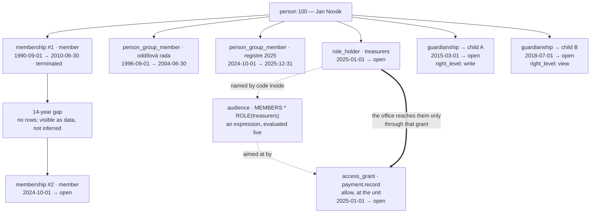

# Appendix — ERD: the temporal pattern, the table inventory, the foreign keys

How a dated row is written so that an answer survives the thing it describes, then one entry per entity in the whole system, and every reference between them.

**Section numbers are shared across the three parts** and never renumbered, because other pages cite them by number and their anchors are built from them: [erd.md](erd.md) holds §1–§4, the diagrams of the people — identity and attributes, the unit's groups and offices, membership, guardianship; [erd-a-authorization.md](erd-a-authorization.md) holds §5–§5b, the whole authorization answer, its tables and the audience expression tree; [erd-b-inventory.md](erd-b-inventory.md) holds §6–§8, the temporal pattern, the table inventory and the foreign key summary.

---

## 6. Temporal pattern, illustrated

Every `[T]` table above uses the same shape. The returning-member case shows why:

Note the two membership rows have the **same type**. They differ only in period and end reason:
this person was a member twice, and a membership carries no age — the type is a fee and renewal
parameter, not a kind of person
([D-038](../decisions/round-02-03.md#d-038--membership-is-ageless)).

**Where the first row came from is not drawn.** A 1990s roster row
states a period of membership, and since
[D-093](../decisions/round-09.md#d-093--the-one-off-import-may-create-memberships-both-ends-dated) one
reviewed batch may turn that stated period into membership #1 itself: both ends dated, `data_confidence`
low, the batch id on it, **no** `fee_obligation` and a balance that stays absent rather than zero, because
the corpus carries no money in it
([D-090](../decisions/round-07-08.md#d-090--the-legacy-corpus-is-thousands-of-roster-rows-with-numbers-and-no-money)).
Two shapes remain forbidden, and they are the two the ban was ever really about: an **open-ended** imported
membership, and one **inferred from an attendance row**. A closed period gates nothing in the present; an
open one hands authority to whoever signs up under that name tomorrow. A people batch writes the
membership and nothing else — a membership has no twin row beside it
([D-097](../decisions/round-10a.md#d-097--there-are-no-sub-units-the-unit-is-a-scope-not-a-row)) — and
the group rows are written by somebody who knows the group exists
([../domain/03-identity-and-legacy.md §7](../domain/03-identity-and-legacy.md#7-legacy-import-pipeline)).

Questions this shape supports, none of which a flag on the person row could answer:

- Was this person a member on 1998-06-01?
- How many years of membership, excluding the gap?
- Which groups were they in during 2003? — `person_group_member` answers it, because those rows are dated
  rather than derived from a rule that could change its mind.
- Who held the office of `treasurers` in 2023? — the same shape of answer, one `role_holder` row, which is
  why [F-12](../open-questions.md#f-12) is answered *no*: an office is held by a named person.
- Would that grant have reached them on that date? — holder row, expression and grant are all evaluated as
  of the same `at`, and none of the three may be stored as a materialized list
  ([D-101](../decisions/round-10b.md#d-101--an-audience-is-an-expression-over-named-sets-stored-as-a-tree)).
- How old were they when they joined the second time? — answered from `person.birth_date`,
  which the membership rows never copy.
- Who are the returning members — more than one membership with a gap between?

Every one of them is answered as of a date, and an as-of date must be applied to every join in
the answer, not only to the first one — a period joined without it leaks the present into the
past. That is what the `[T]` marking on the tables above exists to make visible.

---

## 7. Table inventory

One entry per entity: what it is, what it references, how many may exist, and whether it is
temporal. `⇒` marks a polymorphic reference with no foreign key. Entries that exist **only** to
join two other entities say so. A table that no longer exists is not here: this is the inventory of
what the schema is now, and every gone name has its row in
[removed-concepts.md](removed-concepts.md).

**Read the `[T]` column as a decision, not a default.** A `no` is normally a lookup table, a
definition, or an append-only trail — the kinds of thing that have no period to carry. Exactly one
`no` in this inventory is a choice about a person's data rather than a lack of one:
`person_attribute`, and the reason is written out under its own block below and in §1a.

**Identity**

| Entity | What it is | Points at | How many | [T] |
|---|---|---|---|---|
| `person` | The human being. Holds identity only — no status, no role, no membership | Nothing, except itself: `merged_into_person_id` ⇒ self | One per human, effectively; a merged row survives as a tombstone and is never deleted. The pointer is **never rewritten forward** when the survivor is itself absorbed, so chains persist and `resolve_person()` walks them ([D-087](../decisions/round-07-08.md#d-087--merge-chains-stay-because-reversing-a-merge-is-a-supported-operation)) | no |
| `person_name` | One name a person has had, and when | `person` | Many per person; one current row per `name_type` | yes |
| `account` | The ability to log in. Optional, and independent of membership | `person` | Zero or many per person over a lifetime; at most one **live** row | no |
| `account_credential` | One authentication method's secret or external handle | `account` — deliberately not `person` | Many per account; one current row per external issuer and reference pair | yes |
| `person_contact` | An email, phone or postal address, as a dated row rather than a column | `person` | Many per person; one current primary per type and purpose | yes |
| `person_identifier` | An identifier issued outside the system | `person`; `identifier_scheme` for its `scheme` | Many per person; `(scheme, value)` unique among current rows | yes |
| `identifier_scheme` | The vocabulary of identifier schemes | Nothing | Lookup table, one row per scheme | no |
| `identity_hypothesis` | A *proposal* that two person rows are the same human | `person` twice; the reviewer is a `person` | At most one live hypothesis per pair; a rejected pair may be re-proposed | no |
| `person_merge` | The record that one row was absorbed into another, and how to undo it | `person` twice; `identity_hypothesis`, optional | One per merge performed; a reversal is recorded on the same row | no |
| `field_conflict` | One value a merge could not decide between two candidates — raised for either half of the record, an identity field or a descriptive value ([§1a](erd.md#1a-personal-attributes--everything-that-is-not-a-name-a-gender-or-an-age)) | `person_merge`; `⇒ (entity_table, entity_id)` — polymorphic by nature | Many per merge | no |

**Personal attributes** — everything known about a person other than name, gender and age
([§1a](erd.md#1a-personal-attributes--everything-that-is-not-a-name-a-gender-or-an-age))

| Entity | What it is | Points at | How many | [T] |
|---|---|---|---|---|
| `attribute_definition` | One thing the organization collects about people: the code, its label, its type, and whether several values may be current at once | Nothing | One code per **normalized** spelling — `Allergy` and `allergy ` are one row; statuses `proposed`, `live`, `retired`, and retiring keeps the row and its values | no |
| `attribute_option` | One allowed value of a `one_of` definition | `attribute_definition` | One row per code per definition; a retired option is never re-meaning, because values stored against it are historical facts | no |
| `person_attribute` | The value one person currently has for one code | `person`, `attribute_definition`, and `attribute_option` when the type is `one_of` | One current row per person and code; more only where the definition sets `allow_multiple`, which no constraint can check (it reads another table) | **no — deliberately** |

**That last `no` is the decision, and it is the reason this row spells it out.** Values are
overwritten in place and `audit_log` — carrying the values themselves, **for 24 months** — is the only
history. This is the one place in the schema where *"what did we believe in 2019?"* is answered from the
trail rather than from business data, and the answer reaches **two years back and no further**
([D-088](../decisions/round-07-08.md#d-088--the-accounting-skeleton-is-permanent-the-audit-trail-is-short)):
the honest description of this trade is *no long history*, not merely *no temporal columns*, and the trail
carrying it is discipline rather than guarantee
([D-081](../decisions/round-06.md#d-081--rule-names-survive-the-deletion-of-their-mechanisms-a-renamed-rule-must-say-who-enforces-it-now)).
*Why this is written out on one row of an inventory: if a case ever needs the long version, the fix is
temporal values on this table, not a longer trail — a decision worth one entry, and the argument for it is
in
[D-085](../decisions/round-07-08.md#d-085--the-identity-machinery-stays-structured-the-boundary-is-rules-not-sensitivity)
and [../data-model/09-attributes.md §3](../data-model/09-attributes.md#3-person_attribute--a-value-one-person-has).*
The two vocabulary tables carry **status instead of periods**, which is what lets a code be retired
without touching a fact; only redacting a person erases values, and a redacted person still holding
attribute rows, or still having their values readable in the trail, means the redaction did not happen
([../data-model/09-attributes.md §8](../data-model/09-attributes.md#8-integrity-checks)).

**Groups and offices** — what the organization module holds now ([§2](erd.md#2-organization)), plus the two
office tables it shares with authorization, drawn in [§5a](erd-a-authorization.md#5a-authorization--the-tables) and specified in
[../data-model/05-authorization.md §3](../data-model/05-authorization.md#3-role--an-office)
and [§4](../data-model/05-authorization.md#4-role_holder--who-holds-an-office)

| Entity | What it is | Points at | How many | [T] |
|---|---|---|---|---|
| `person_group` | A named set of people with a lifetime — a crew, a registration team, everyone who ever ran the camp. **Confers nothing**: authority arrives only through a grant aimed at the group | Nothing. Its `name` is unique **together with** `role.code` and a set audience's `code`, which no constraint can express, so the write path carries the rule and an integrity check asserts the write path still does | One row per name. Ended by `valid_to`, never deleted while member rows exist, and **ending** it is refused while a live grant — or a live audience reachable from one — names it, because `EVERYONE - GROUP(x)` with an emptied group denies everybody | yes |
| `person_group_member` | Join entity: this person was in this group for that period. Written by a person, never derived from a rule | `person_group`; `person` — **`person`, not `membership`**, so a 1998 roster row does not have to invent a membership in order to be true; and `person` as the one who added them | Many per group at once; **no overlapping periods for one person in one group, over all rows** including ended ones, which a hand-written exclusion constraint enforces and the write path only explains ([../data-model/02-organization.md §2](../data-model/02-organization.md#2-person_group_member)) | yes |
| `role` | An office — `treasurers`, `registrar`, `counselors`. A definition, valid always; the period lives on the holder row. **It carries no permissions and confers nothing:** the codes an office holds are the live grants whose audience names `ROLE(x)` | Nothing. Its `code` joins the same one namespace as group names, and every reserved `selector_type.code` is refused against it | One row per `code`; deleting one is refused while holder rows exist, so an office cannot be emptied in one save | no |
| `role_holder` | Who holds an office for what period — **one named person, never a rule**: an office record that cannot answer "who held this in 2023" is not one ([F-12](../open-questions.md#f-12)) | `role`; `person` twice — the holder, and the person who appointed them | At most one **open** row per person and role; no overlap over all rows; nothing forces a row to end, and the standing report is the control ([D-071](../decisions/round-05.md#d-071--nothing-forces-a-role-assignment-to-end-the-gate-and-the-report-are-the-control)) | yes |

**Membership**

| Entity | What it is | Points at | How many | [T] |
|---|---|---|---|---|
| `membership_type` | The fee and renewal parameters. One row, `member`, kept as a table so the vocabulary can grow | Nothing | Exactly one row today (D-037) | yes |
| `membership` | One period of membership, with its own ending | `person`, `membership_type`; itself via `renewed_from_membership_id` | Many per person over a lifetime; **one open at a time, ever** | yes |
| `membership_request` | An application. Two person references on purpose: the subject and the submitter | `person` twice, `membership_type`, and `membership` twice (what it produced, what it renews). It names **no group and no unit** beyond the unit itself: which set a new member lands in is a later write on that set, not a term of the application ([D-098](../decisions/round-10a.md#d-098--a-group-is-a-person_group-explicit-members-a-lifetime-and-no-authority)) | At most one **open** request per person | no |

**Relationships**

| Entity | What it is | Points at | How many | [T] |
|---|---|---|---|---|
| `guardianship` | One adult's responsibility for one dependent, carrying one `right_level` | `person` twice — never the same person twice | One current row per pair; unlimited past rows; a dependent may have any number of guardians at once | yes |
| `guardianship_permission` | The temporal history of that row's right level — one value with three choices, changed over time ([D-074](../decisions/round-06.md#d-074--a-guardians-rights-are-none-view-or-write-nothing-more-granular)) | `guardianship` | Exactly one open row per guardianship; its value is what `guardianship.right_level` copies | yes |

**Authorization** — the tables are drawn in [§5a](erd-a-authorization.md#5a-authorization--the-tables) and the expression in
[§5b](erd-a-authorization.md#5b-the-audience-expression)

| Entity | What it is | Points at | How many | [T] |
|---|---|---|---|---|
| `permission` | One coded capability — the only thing a check asks for, and a grant names exactly one | Nothing | One row per code; the code never changes. `applies_to` says whether the code may be granted at the unit or **also** on an item, checked when the grant is saved; `right_kind` exists for exactly one customer, the guardianship channel ([D-099](../decisions/round-10a.md#d-099--a-grant-allows-or-denies-one-permission-there-is-no-level-and-no-locality)) | no |
| `grant_scope_type` | The registry of things a grant may be written on, and the table its id lives in. **`unit` is its only non-item row** — which is where the unit now lives | Nothing | One row per scope kind: `unit`, `event`, `person_group`, `role`, and `document` deferred. Adding a grantable thing is a row here rather than a migration. **`api_key` is deliberately absent**: a key is a grantee and never a thing a permission is granted *on*, so *"rotate the accounting key and no other"* is not a writable grant at this scale, and the debt is recorded rather than hidden ([D-122](../decisions/round-16.md#d-122--what-a-key-owes-the-catalog-four-codes-at-the-unit-and-the-fourth-owed-thing-declined)) | no |
| `access_grant` | **The only table that grants.** A grantee, a scope, one permission, an effect, a period | **Exactly one grantee of three kinds:** `person`, `audience` or `api_key` — never two, never none ([D-116](../decisions/round-16.md#d-116--a-caller-that-is-not-a-person-is-a-registered-key-and-a-key-is-a-third-grantee-kind)); `grant_scope_type` and `⇒ scope_id`, absent exactly at `unit`; `permission`; `person` as grantor, delegator and revoker — always a person, including on a grant whose grantee is a key | At most one live **allow** per grantee, scope **and permission**, counted once per grantee kind so the one rule is **three** partial unique indexes — denies sit outside all three on purpose, because allow-beside-deny is the only way to say *"the unit's events, except this one"*; a delegation must carry an end date, and a grant naming a key is never a delegation and so carries no mandatory expiry ([D-116](../decisions/round-16.md#d-116--a-caller-that-is-not-a-person-is-a-registered-key-and-a-key-is-a-third-grantee-kind), [D-120](../decisions/round-16.md#d-120--a-key-outlives-whoever-created-it-and-the-report-is-the-control)) | yes |
| `audience` | A set of people a grant may name — **an expression over named sets, stored as a tree** ([D-101](../decisions/round-10b.md#d-101--an-audience-is-an-expression-over-named-sets-stored-as-a-tree)) | Its own operand rows; `code` is optional and is the only thing another audience may name ([D-103](../decisions/round-10b.md#d-103--an-audience-may-name-another-audience)); an operand is one named row of the registry, never a stored roster ([D-105](../decisions/round-11-12.md#d-105--there-are-no-lists-a-hand-written-set-is-an-expression-like-any-other)) | One row per audience; the tree is stored exactly as the writer wrote it and its height is bounded by nothing — the save-time cycle walks are the only structural guard, and nothing bounds what resolving one costs, which [D-112](../decisions/round-13.md#d-112--the-systems-scale-is-stated-hundreds-of-people-tens-of-registrants-per-event) accepts at the stated size rather than leaves unaddressed ([D-081](../decisions/round-06.md#d-081--rule-names-survive-the-deletion-of-their-mechanisms-a-renamed-rule-must-say-who-enforces-it-now)); an audience a live grant names is **never deleted** — it is flagged `deprecated`, `hidden` or `disabled`, the first two changing no answer and the third resolving to the empty set on purpose, as an audited write that prints the rules it touches ([D-109](../decisions/round-13.md#d-109--nothing-a-rule-names-is-deleted-deprecated-hidden-disabled--and-a-tab-instead-of-a-report)) — **a flag is a state, not part of a compilation**, so resolution reads it live, once per request, and `disabled` means *now* rather than *next time the rules are compiled* ([D-114](../decisions/round-14.md#d-114--there-is-no-permission-cache-a-check-resolves-a-request-memoizes-and-the-only-cached-thing-is-a-compilation)); an ended audience reaches nobody, so ending one is refused while a live grant names it | yes |
| `audience_operand` | Join entity: **one row of one audience's expression tree** — a node (`operator`, `left_id`, `right_id`) or a leaf (`selector_kind`, `⇒ selector_arg_id`), never both | `audience`, denormalized onto every row so one audience's tree is one indexed fetch; itself, `parent_id` on the child; `selector_type`; and `⇒` a `role`, `person_group`, `audience`, `person` or `event` **with no foreign key** — [D-011](../decisions/round-01a.md#d-011--scope_id-on-access_grant-is-polymorphic-with-no-foreign-key)'s accepted trade-off, extended by D-101 | One row per node or leaf; a node never belongs to another audience than its parent's; the forest is acyclic, checked on save | no |
| `selector_type` | The registry of operands the language has: the reserved word, whether it takes an argument, whether its argument-less form binds to the item being checked, and what type the argument names | Nothing | **Thirteen** seeded rows — the thirteen operands of the language, including `PERSON`, which is what lets an expression name a single human ([D-105](../decisions/round-11-12.md#d-105--there-are-no-lists-a-hand-written-set-is-an-expression-like-any-other)), and including `OLDER(n)` and `YOUNGER(n)`, the two whose `argument_type` is a whole number of years rather than a table and whose set moves with no write at all, because they read `person.birth_date` **on the date being checked** ([D-107](../decisions/round-11-12.md#d-107--the-grammar-opens-an-attribute-may-be-an-operand-and-the-vocabulary-stays-seeded)). Six `argument_type` values, five of them tables; the operators are `+ - *`. Every row `is_system` and organization-read-only, and every row both seeded and shipped — a code with no evaluator arm is a deployment bug, not a held feature ([D-104](../decisions/round-10b.md#d-104--a-permission-codes-last-segment-is-an-action-and-a-registry-that-prose-contradicts-is-a-fiction)) | no |
| `api_key` | **A caller that is nobody**: one registered integration, installed by a named person, holding one live secret that is shown once and kept only as a hash. Not an account (a way for a person to log in), not an office (held by a person, confers nothing), not a selector (no expression can name one) — and so a grantee in exactly the sense a person is ([D-116](../decisions/round-16.md#d-116--a-caller-that-is-not-a-person-is-a-registered-key-and-a-key-is-a-third-grantee-kind)) | `person` as `owner_person_id` — **a contact, not a channel**, never read to decide an answer; `person` as `created_by`, required, because attribution for an act is not a dependency of the authority; `person` as revoker. Grants name it from `access_grant.api_key_id`, a real foreign key and not a third reference-less key (§8) | One row per integration; `code` and `secret_hash` each unique among live rows — the second a lookup before it is a constraint; `valid_to` optional, absent meaning current, and **nothing forces a key to end**: the report is the control ([D-120](../decisions/round-16.md#d-120--a-key-outlives-whoever-created-it-and-the-report-is-the-control)). Rotating replaces the hash in place, so there is no window in which both secrets work and no history of past ones ([D-119](../decisions/round-16.md#d-119--a-key-is-one-row-holding-one-live-secret-and-it-rotates-in-place)). Nothing at all is derived from `created_by`, and no key is ever inside an expression — the registry keeps its thirteen rows and none of them names a key ([D-117](../decisions/round-16.md#d-117--a-key-is-never-inside-an-expression-thirteen-selectors-and-none-of-them-can-name-one)) | yes |
| `access_log` | The audit trail — who did what, by what authority, with what result | `person` as actor and as subject, **or** `api_key` as actor instead of a person — the two are never both set; `⇒ authorization_ref_id` naming `access_grant` **or** `guardianship_permission` — the enum holds exactly those two channels, so an older row reading `role` or `system` names a channel this model cannot read, which is deliberate ([D-100](../decisions/round-10a.md#d-100--a-role-is-an-office-and-a-group-is-company-two-tables-of-the-same-shape)); `⇒ entity_id` | Append-only today; **proposed** to take the same 24-month window as the audit payload, which would make this cell wrong as written — **F-8**, unconfirmed ([D-088](../decisions/round-07-08.md#d-088--the-accounting-skeleton-is-permanent-the-audit-trail-is-short)) | no |

`role` and `role_holder` are inventoried under **Groups and offices** above, where the module keeps them;
both are drawn in the authorization diagram, because that is where a reader meets what they do — which is
nothing at all, on their own.

**Audit and import**

| Entity | What it is | Points at | How many | [T] |
|---|---|---|---|---|
| `audit_log` | The row-level trail of changes to business tables, **before and after values included until the payload window passes** | `⇒ (table_name, record_id)` — polymorphic; `person` as actor, and on whose behalf, **or** `api_key` as actor instead of a person — the two actor columns are mutually exclusive and `on_behalf_of` is never set on a row whose actor is a key ([D-121](../decisions/round-16.md#d-121--a-key-never-carries-a-persons-authority)); **a row naming neither is this system acting on its own**, a complete answer to *who did this*, and the trail's own `actor_label` then says which writer it was, from a fixed list rather than from free text ([../data-model/00-conventions.md §7a](../data-model/00-conventions.md#7a-what-an-empty-actor-column-means), [D-125](../decisions/round-17.md#d-125--an-empty-actor-column-is-this-system-acting-on-its-own-and-its-name-comes-from-a-fixed-list)) | One row per change; the row is never deleted, but a scheduled **payload reduction** empties the values 24 months after writing ([D-088](../decisions/round-07-08.md#d-088--the-accounting-skeleton-is-permanent-the-audit-trail-is-short)) | no |
| `redaction_log` | That a redaction happened to a person, by whom, and to what | `person`; the person who requested and the person who performed it | One per redaction performed | no |
| `import_batch` | One arrival of historical data, where it stands, which half of the corpus it carries (`people` or `events`), and the raw-column→code map a person read before it applied | `person` as creator, applier and reverting party | One per batch; the map lives here as one object rather than per staged row, because it is one artefact a human reads top to bottom and the codes it names arrive `live` ([D-090](../decisions/round-07-08.md#d-090--the-legacy-corpus-is-thousands-of-roster-rows-with-numbers-and-no-money), [D-092](../decisions/round-09.md#d-092--the-corpus-is-people-and-events-and-it-names-no-units)); staging rows may be truncated once applied | no |
| `staging_import` | A raw source row, verbatim, with its file and line | `import_batch` | One per source row per batch | no |
| `staging_import_row` | That row parsed, plus what the parse could not decide, and what it eventually created | `staging_import`; `person` as resolver; and what it created — `person` and, on a people batch, the `membership` whose **both ends** the source stated ([D-093](../decisions/round-09.md#d-093--the-one-off-import-may-create-memberships-both-ends-dated): a stated period may be imported, an open-ended one may not and one inferred from attendance may not), and on an events batch the `event` and the `event_registration` | One per staged row | no |

**Finance** *(provisional)*

| Entity | What it is | Points at | How many | [T] |
|---|---|---|---|---|
| `fee_schedule` | What may be charged, for what kind of period | `membership_type`, optional — absent means it applies to any type. A schedule is organization-wide by construction: there is no unit row to attach one to ([D-097](../decisions/round-10a.md#d-097--there-are-no-sub-units-the-unit-is-a-scope-not-a-row)) | As the organization defines | yes |
| `fee_obligation` | What one person owes for exactly one thing | `person` (who it is *for*), `fee_schedule`, and **exactly one** of `membership`, `membership_request`, `event_registration` | Many per person; the target is never two and never none. An **imported** membership creates none, and its `outstanding_balance` is `NULL` rather than zero, because zero would be a claim the export does not support ([D-093](../decisions/round-09.md#d-093--the-one-off-import-may-create-memberships-both-ends-dated)) | no |
| `payment` | Money that arrived | `person` as payer — deliberately not the person the fee is for | One per recorded receipt | no |
| `payment_allocation` | Join entity: this payment counted towards this obligation, by how much | `payment`, `fee_obligation` | A given payment is allocated to a given obligation at most once | no |
| `payment_request` | The ask, carrying the variable symbol that ties a bank transfer back to it | `fee_obligation` — the amount is copied, never recomputed | Several per obligation over time; **at most one live**; the symbol is unique over every symbol ever issued | no |
| `bank_transaction` | One incoming transfer as the bank reported it | `payment_request` when matched — absent means it is in the queue; `import_batch` | Unique per bank reference within an account; immutable once imported | no |

**Events**

| Entity | What it is | Points at | How many | [T] |
|---|---|---|---|---|
| `event` | A dated occasion people register for. **Owned by nobody** | `fee_schedule`, optional, when it costs money. It belongs to **no unit and nobody**: the people connected to an event are named by operands that bind to it (`ORGANIZERS`, `PLACED`, `CONFIRMED`, `ATTENDED`, `ON_WAITLIST`), so there is no owner for a check to ask ([D-102](../decisions/round-10b.md#d-102--nothing-owns-an-event-the-people-connected-to-it-are-named-by-selectors-that-bind-to-it)). `created_by` is attribution, not ownership, as [D-005](../decisions/round-01a.md#d-005--permissions-are-grants-never-derived-from-identity) says | One row per occasion; no recurrence, no series | no |
| `event_organizer` | Who is running an event, with a label and an order — an appointment, not a grant ([D-062](../decisions/round-05.md#d-062--organizers-are-appointed-on-the-event-not-granted)) | `event`, `person` | Many per event; the list is the domain answer to "who runs this", and it is **the one cascade delete in this design** ([§8](#8-foreign-key-summary)) | no |
| `event_registration` | One person's answer about one event, plus whether they turned up | `event`, `person` — `person`, never `membership`, so a 1998 camp roster does not smuggle its people into `MEMBERS` today | One per person per event; unanswered is the **absence** of a row (D-059); `was_present` is three-valued and is deliberately the basis of no selector | no |
| `event_question` | One thing this event asks, of attendees, organizers or both | `event` | As many as the event asks; defined per event, never shared | yes |
| `event_answer` | What one person said to one question, stored as a row and not as JSON | `event_question`; `person` — **who answered**, for a child the child, not the registration row and not whoever submitted on their behalf | One row per question per answerer | no |

**Reference vocabularies** — `grant_scope_type`, `selector_type`, `identifier_scheme`,
`permission`. Four, and one fewer than this page used to list: `reason_code` is deleted by
[D-128](../decisions/round-18.md#d-128--a-reason-is-text-the-reason_code-table-is-deleted), because a
reason is what a person writes, not a row to maintain. Each is named by a value held elsewhere rather than pointing at
anything, and each exists so that a vocabulary is data the organization can see rather than a list inside
the application. `attribute_definition` is the same kind of thing in spirit and a different shape in fact — it has a
curation lifecycle, a child table, and rows pointing back at it — so it is inventoried above rather than
here.

> **`event` carries no `[T]`** — it has no `valid_from` /
> `valid_to`, because an event is a dated occasion rather than a period-tracked record. Its
> lifecycle is `starts_at` / `ends_at` / `cancelled_at`, and it has no `status` column at all
> ([D-064](../decisions/round-05.md#d-064--there-is-no-event-status-visibility-is-the-permission-model)).
> `event_registration` likewise stores no period: a person is attending, or they are not, and
> "unanswered" is the absence of a row
> ([D-059](../decisions/round-05.md#d-059--unanswered-is-the-absence-of-a-row-a-registration-stores-two-values)).

**[T]** = temporal, carries `valid_from` / `valid_to`. A `no` says it does not; where the *reason*
for not is a decision about someone's data rather than the nature of the table, the row says so —
which in this inventory is `person_attribute`, and nowhere else.

---

## 8. Foreign key summary

Columns with no FK, and why:

| Column | Why no FK |
|--------|-----------|
| `access_grant.scope_id` | Polymorphic by design. Validated by `grant_scope_type` + orphan checks. It is **absent exactly when the scope type is `unit`**, and that absence is the schema-level form of "the unit is a scope, not a row" ([D-097](../decisions/round-10a.md#d-097--there-are-no-sub-units-the-unit-is-a-scope-not-a-row)). |
| `audience_operand.selector_arg_id` | The second one, and newer: one integer pointing at a `role`, a `person_group`, an `audience`, a `person` or an `event` depending on `selector_kind`, resolved by `selector_type.argument_type` and caught by the same nightly orphan scan. [D-101](../decisions/round-10b.md#d-101--an-audience-is-an-expression-over-named-sets-stored-as-a-tree) carried [D-011](../decisions/round-01a.md#d-011--scope_id-on-access_grant-is-polymorphic-with-no-foreign-key)'s trade-off across deliberately, mitigations included — the registry is the only thing that says which table an id belongs to, so an unmapped kind is the empty set, not an error. **It also sometimes holds no reference at all**: `OLDER(n)` and `YOUNGER(n)` store a whole number of years here ([D-107](../decisions/round-11-12.md#d-107--the-grammar-opens-an-attribute-may-be-an-operand-and-the-vocabulary-stays-seeded)), and that does not make a third key — `18` points at nothing, so the orphan scan has nothing to walk, a merge has nothing to repoint, and this row is still describing one column that sometimes carries a reference and sometimes carries a scalar. |
| `access_log.scope_id` | Same shape as the grant's; absent for a check at the unit. |
| `access_log.authorization_ref_id` | Points at **one of two** tables, `access_grant` or `guardianship_permission`, and nothing else; a historical row whose channel reads `role` keeps the word and loses the reference, which is the honest state of a value whose table is gone ([D-100](../decisions/round-10a.md#d-100--a-role-is-an-office-and-a-group-is-company-two-tables-of-the-same-shape)). |
| `access_log.entity_id` | Polymorphic target of the audited action. |
| `field_conflict.entity_id` | Polymorphic; recorded alongside `entity_table`. |
| `audit_log.record_id` | Polymorphic; recorded alongside `table_name`. |

**There are exactly two reference-less keys, and the class matters more than the count.**
`access_grant.scope_id` and `audience_operand.selector_arg_id` are ids with no constraint behind them, and
each carries the same four things that make that survivable: a registry saying which table an id belongs
to, a save-path check against that registry, an orphan scan the scheduler owns, and an explicit rule that a
failure resolves to the empty set
([../data-model/00-conventions.md §9](../data-model/00-conventions.md#9-referential-integrity-rules)).
A scalar is not a third one: `OLDER(n)` and `YOUNGER(n)` write a whole number of years into
`audience_operand.selector_arg_id`, and there is no table that number should have named, so there is no
registry lookup to miss, no orphan for the scan to find and nothing for a merge to repoint. The count is
about references, and `18` is not one
([D-107](../decisions/round-11-12.md#d-107--the-grammar-opens-an-attribute-may-be-an-operand-and-the-vocabulary-stays-seeded)).
A third candidate arrived with `api_key` and is not one either: `access_grant.api_key_id` names exactly
one table, always, so it carries an ordinary foreign key and needs none of the four things above — no
registry saying which table it means, no save-path check against that registry, no orphan for the scan, no
rule about what an unreadable kind resolves to. **Becoming the third grantee cost a column with a
constraint, not a column without one**
([D-116](../decisions/round-16.md#d-116--a-caller-that-is-not-a-person-is-a-registered-key-and-a-key-is-a-third-grantee-kind)).

`access_grant` has **no `grantee` column** — that is the one **mutual-exclusion** case rather than a
missing-FK case: exactly one of `person_id` / `audience_id` / `api_key_id` is set, never two, never none.
All three columns are nullable, so nothing but the rule says whom a grant means; a grant naming none is
meaningless and one naming two is ambiguous about whom in the audience it speaks for. The three are not
three spellings of one thing: a person and a key are read exactly as written, and only an audience is an
expression evaluated as of the date being checked
([D-116](../decisions/round-16.md#d-116--a-caller-that-is-not-a-person-is-a-registered-key-and-a-key-is-a-third-grantee-kind),
[D-117](../decisions/round-16.md#d-117--a-key-is-never-inside-an-expression-thirteen-selectors-and-none-of-them-can-name-one)).
`audience_operand` carries the same shape of rule one table down — `operator` with `left_id`/`right_id`,
**or** `selector_kind` with `selector_arg_id` where the registry says the code takes an argument — and for
the same reason: a row satisfying neither is a node in no tree, and an expression containing one resolves
to nobody.

Every other column ending in `_id` has a real foreign key with `ON DELETE RESTRICT` — the newest of them
`api_key`'s `owner_person_id`, `created_by` and `revoked_by`, and the `api_key_id` carried by
`access_grant`, `access_log` and `audit_log` — **with one exception**: `event_organizer.event_id` is the
single `ON DELETE CASCADE` in the design — an appointment is nothing once the occasion it appointed
somebody to is gone, and the guards in
[../data-model/08a-event-guards-and-checks.md §8](../data-model/08a-event-guards-and-checks.md#8-projections-and-guards) are what make that
delete safe to allow at all. Two operands whose argument is an integer add no key and no cascade, because
there is no row for either to be a child of — still one cascading column, still `event_organizer.event_id`.
Everything else that merely looks like a child restricts: a registration, an answer, a member row, a holder
row, a grant. The general rule, and this one exception, are written down once in
[../data-model/00-conventions.md §9](../data-model/00-conventions.md#9-referential-integrity-rules) —
nothing cascades in front of a 40-year trail.
