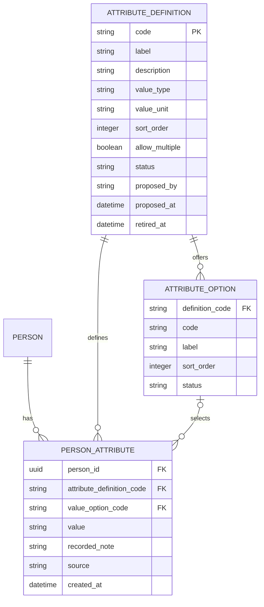
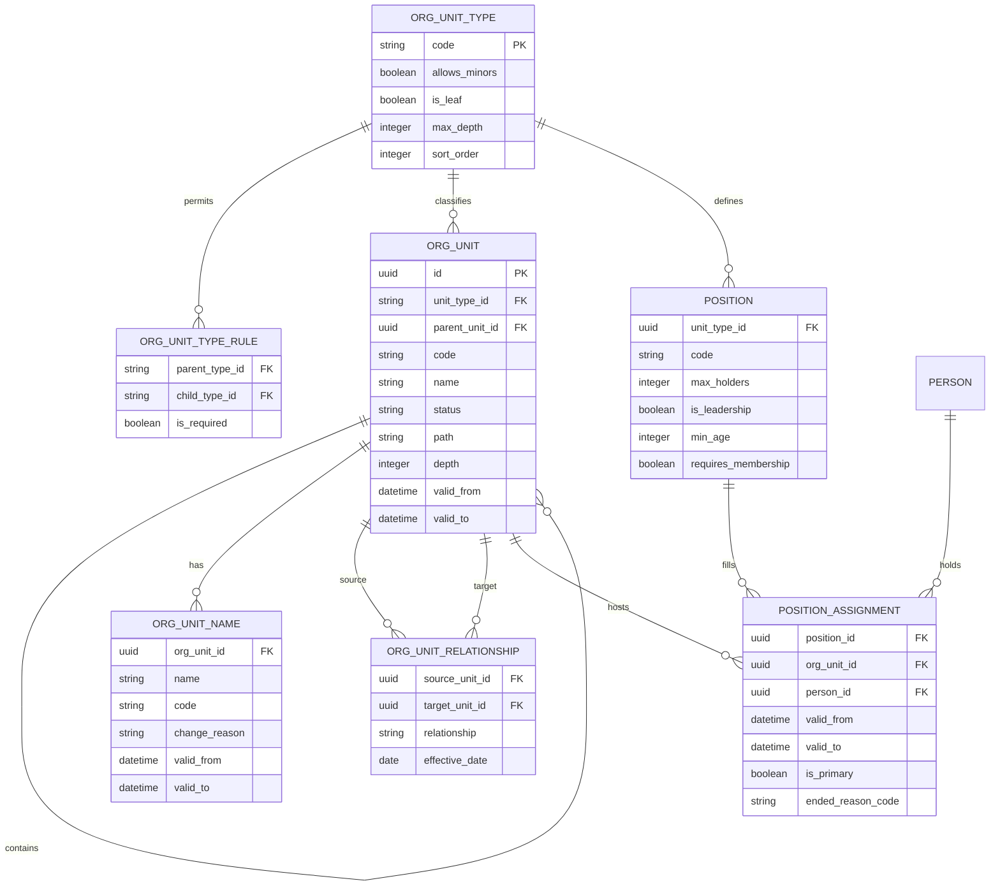
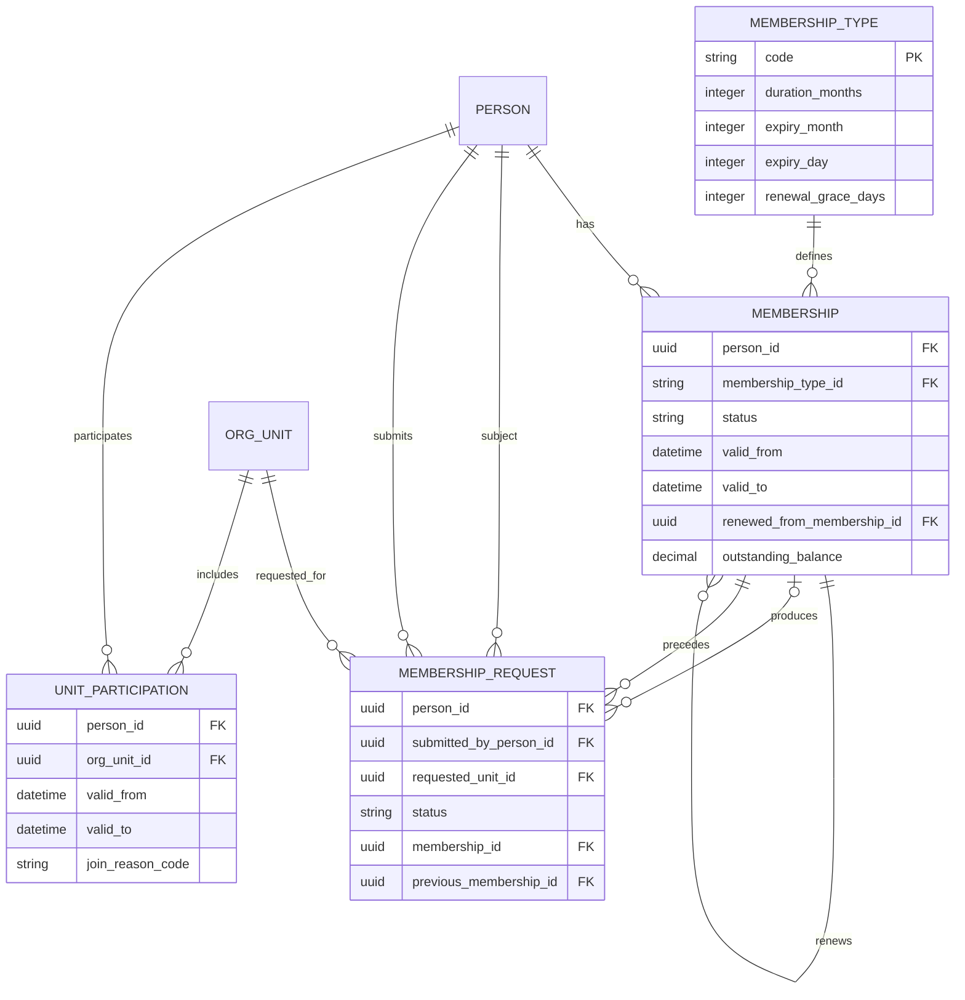
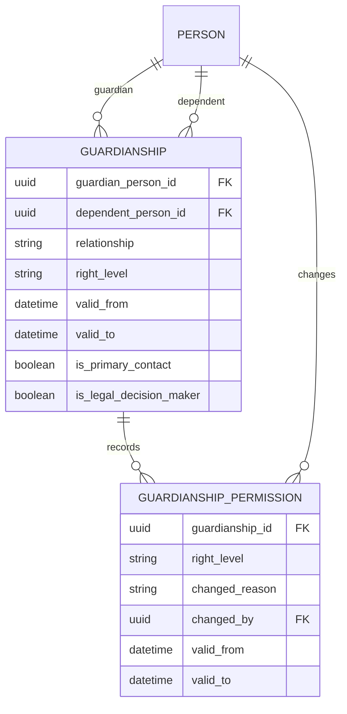
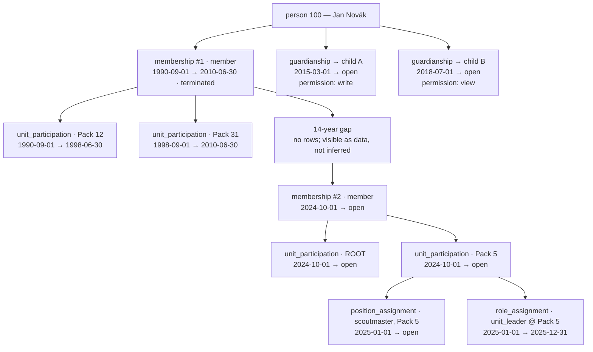

# Appendix — Entity Relationship Diagrams

This appendix describes **relationships** — what points at what, how many, and whether the
link is temporal. Field-level definitions live in the data-model documents, each in the one
that owns the entity, and are deliberately not repeated here.

Diagrams of the schema in [../data-model/00-conventions.md](../data-model/00-conventions.md).
Split by subject area so each
stays readable; the areas connect through `person`, which appears in all of them.

Notation: `→` is a foreign key pointing at the referenced table. `⇒` is a polymorphic
reference (no database-level foreign key). Temporal tables are marked `[T]`.

---

## 1. Identity


**Key point:** everything hangs off `person`, and `person` itself holds only identity.
No status, no role, no membership — everything else the organization records about the human is
the descriptive layer drawn next. See
[../data-model/01-identity.md](../data-model/01-identity.md#1-the-central-claim).

---

## 1a. Personal attributes — everything that is not a name, a gender or an age



**Key point:** these three tables are the whole of what the system knows about a person beyond
name, gender and age. There is no health table beside them and no privileged corner inside them:
[D-083](../decisions/decision-log.md#d-083--there-is-no-medical-record-personal-data-is-one-class-of-data)
removed the category and
[D-084](../decisions/decision-log.md#d-084--descriptive-data-is-organization-defined-at-runtime)
put an organization-maintained vocabulary in its place. Reading is `person.view`, writing is
`person.edit`, and only the vocabulary needs a code of its own
([`attribute.define`](permission-catalog.md#2-people-and-identity)). Fields and rules:
[../data-model/09-attributes.md](../data-model/09-attributes.md).

**None of the three is `[T]`, and the `no` beside them in §7 is a decision, not an omission.** A
`person_attribute` row is **the current belief, overwritten in place**, and `audit_log` holds the
sequence of beliefs, **values included for as long as the payload window lasts — 24 months, after
which the row is reduced and the values are gone**
([D-088](../decisions/decision-log.md#d-088--the-accounting-skeleton-is-permanent-the-audit-trail-is-short))
— which is why the trail is guarded as person data is
([the permission catalog §8](permission-catalog.md#8-audit-and-system)). This corpus gives periods to things that are true *over an interval* — a
membership, an address, a position, a guardian's authority — and a descriptive value is not one of
those: it is a statement made now about whatever it is about, with a timestamp on the assertion. A
`valid_from` here would ask a volunteer when an allergy began, which is a question the
organization is not competent to record and has no rule that could use
([D-085](../decisions/decision-log.md#d-085--the-identity-machinery-stays-structured-the-boundary-is-rules-not-sensitivity)).
The cost is named rather than left out: the history of a value lives in the one control
[D-081](../decisions/decision-log.md#d-081--rule-names-survive-the-deletion-of-their-mechanisms-a-renamed-rule-must-say-who-enforces-it-now)
calls the corpus's weakest, and §7 lists it as the accepted risk. It is also a deliberate
departure from `guardianship` two sections below, which keeps its current value *and* its history
in business tables — because authority is asked "what was it on that date?" as a routine part of
answering whether an act was permitted, and an allergy list is not.

The two vocabulary tables are non-temporal for a smaller reason of their own: a code leaves
service by **status**, not by a period, so a value recorded against a retired option keeps meaning
what it meant on the day it was chosen. Retiring therefore never touches a fact — only redacting a
person erases one ([../domain/08-person-data.md](../domain/08-person-data.md#5-forgetting)).

---

## 2. Organization



**Key point:** `path`/`depth` are denormalized for fast subtree queries; `unit_ancestors()`
and `unit_descendants()` are the authority — **for reporting only**. They are never used in
a permission path: authority does not flow down the unit tree. Positions do **not** grant
permissions, and several people may occupy the same position (`position.max_holders`).

See [../data-model/02-organization.md](../data-model/02-organization.md) and
[../domain/06-authorization-model.md](../domain/06-authorization-model.md#2-scope-authority--no-downward-inheritance).

---

## 3. Membership



**Three points that matter:**

- `membership_request` has **two** person references:
  `person_id` (the child, who would become a member) and `submitted_by_person_id` (the
  parent, who applied). Collapsing them makes the audit trail false.
- `unit_participation.person_id` points at **person**, not membership. This is the deliberate
  trade-off that makes the 1990s import possible — an imported roster records who took part,
  and **no imported row ever has a membership to point at**, because the corpus carries no payment
  evidence and a roster therefore evidences participation only
  ([D-090](../decisions/decision-log.md#d-090--the-legacy-corpus-is-thousands-of-roster-rows-with-numbers-and-no-money)).
  This bullet used to read "frequently", while the import still imagined membership rows. Field
  rules: [../data-model/03-membership.md](../data-model/03-membership.md#5-unit_participation).
- **`membership_type` exists with exactly one row**, and `category`, `min_age`, `max_age`
  and `requires_background_check` are all gone. Membership is ageless
  ([D-038](../decisions/decision-log.md#d-038--membership-is-ageless)); age is read from
  `person.birth_date` where it matters, which is guardianship and position eligibility, not
  membership.

---

## 4. Guardianship



**Key point:** guardianship is a general graph — one guardian → many dependents, many
guardians → one dependent, and a person may be both. Authority is per `guardianship` row, and
since [D-074](../decisions/decision-log.md#d-074--a-guardians-rights-are-none-view-or-write-nothing-more-granular)
that row carries one value — `none`, `view` or `write` — so a parent may write one child's
records and only read another's. See
[../data-model/04-relationships.md](../data-model/04-relationships.md).

---

## 5. Authorization — the whole answer in one diagram

```
                    ┌──────────────────┐
                    │    permission    │   'membership.request.approve'
                    │  code, resource  │   'guardianship.change_right'
                    │  namespace       │   'event.register_self'
                    └────────┬─────────┘
                             │
              ┌──────────────┴───────────────┐
              │                              │
              ▼                              ▼
    ┌──────────────────┐          ┌────────────────────┐
    │ role_permission  │          │  permission_level  │
    └────────┬─────────┘          │   scope_type       │
             │                    │   required_level   │  ── connects permission
             ▼                    └─────────┬──────────┘     codes to grant LEVELS
    ┌──────────────────┐                    │
    │       role       │          ┌─────────┴──────────┐
    │  code            │          │   access_level     │
    │  scope_required  │          │   rank 0/10/20/30/40│  ← COMPARE BY RANK,
    │  requires_member │          │   revoked…admin     │     NEVER BY STRING
    │   _ship         │          └─────────┬──────────┘
    │  (no period)     │  ← a ROLE is a DEFINITION and is valid ALWAYS (D-053).
    └────────┬─────────┘    The period lives on role_assignment, never here. A role
             │              ever assigned cannot be deleted, and is never switched off
             │                              │
             │   the membership gate has TWO waivers:
             │     role.requires_membership = false   (this ROLE)
             │     system.gate_exempt, a permission   (this PERSON, D-051)
             │   — the second arrives by the same route as any permission,
             │     through role_permission, and is never reachable by a grant
             ▼                              ▼
   ╔═══════════════════════╗    ╔═════════════════════════╗
   ║   role_assignment     ║    ║      access_grant       ║
   ║  SYSTEM-WIDE AUTHORITY║    ║   PER-ITEM AUTHORITY    ║
   ║                       ║    ║                         ║
   ║ person_id             ║    ║ person_id               ║
   ║ role_id               ║    ║ scope_type ─────────────╫──► grant_scope_type
   ║ scope_type:           ║    ║ scope_id  ⇒ (polymorphic)║
   ║   organization        ║    ║ level ──────────────────╫──► access_level
   ║   | org_unit          ║    ║ valid_from / valid_to   ║
   ║ scope_id              ║    ║ is_delegated            ║
   ║ valid_from/valid_to[T]║    ║ delegated_from ─────────╫──► person
   ║ delegation_of ──┐self ║    ║ revoked_at              ║
   ║                 └─────║    ╚═════════════════════════╝
   ╚═══════════════════════╝
             │                              │
             │              ┌───────────────┘
             │              │
             │              │      ╔═════════════════════════╗
             │              │      ║     scope_exposure      ║
             │              │      ║  THE ONLY DOWNWARD      ║
             │              │      ║  CROSSING               ║
             │              │      ║                         ║
             │              │      ║ org_unit_id  = GRANTOR  ║──► org_unit
             │              │      ║ role_assignment_id ─────╫──► role_assignment
             │              │      ║ valid_from / valid_to[T]║
             │              │      ║ exposed_by / exposed_at ║
             │              │      ║ withdrawn_by / _at      ║
             │              │      ╚═════════════════════════╝
             │              │                 │
             │              │  the unit offers │ its own
             │              │  coverage over   │ assignment
             │              │  itself ─────────┘
             │              │
             │              │      ╔═════════════════════════╗
             │              │      ║        audience         ║  A grant may name a
             │              │      ║  kind: builtin | group  ║  SET of people instead
             │              │      ║  rule_key  (builtin)    ║  of a person.      (D-042)
             │              │      ║  ─────────────────────  ║
             │              │      ║  audience_member [T]    ║  ← only for kind='group';
             │              │      ║   (named groups only)   ║    built-ins are RULES,
             │              │      ╚═════════════┬═══════════╝    not stored lists
             │              │                    │
             └──────────────┴───────────────┬────┴──────────┘
                                            ▼
                 ╔═══════════════════════╗
                 ║       can(p, perm,    ║   ONE resolver.
                 ║         scope, at)    ║   Deny first, then
                 ╚═══════════┬═══════════╝   locality. Four steps.
                             │
              ┌──────────────┼──────────────┬───────────────┬──────────────┐
              ▼              ▼              ▼               ▼              ▼
       0. explicit      1. ownership   2. guardian-    3. ALLOW:      4. default
          DENY           (own row)      ship            most specific    DENY
          (revoked)      ─ gate-exempt  (subject≠actor) scope wins
          ABSOLUTE at                   ─ gate-exempt   the LEVEL
          ANY scope                     allows only     │
          ─ to a person                                │
            OR an                                     │
            audience                                 │
                                       ┌──────────────┼──────────────┐
                                       ▼              ▼              ▼
                                  a. ITEM grant   b. UNIT grant   c. ORG grant
                                     (access_        (access_        (access_
                                      grant)          grant)          grant)
                                       │              │              │
                                       │              │ exact scope  │
                                       │              │ only — never │
                                       │              │ widened by   │
                                       │              │ an exposure  │
                                       └──────────────┴──────────────┴──► d. ROLE
                                                                            (role_assignment;
                                                                             org role, exact unit,
                                                                             or a unit exposed to
                                                                             THAT assignment (D-078).
                                                                             NOT inherited)
                                                                            ⚠ MEMBERSHIP GATE
                                                                              applies HERE ONLY
                                                                              (D-039): no current
                                                                              membership → the
                                                                              role grants nothing,
                                                                              unless the role
                                                                              opts out.
```

**Key points:**

- `role_assignment` and `access_grant` are the same idea at two granularities: authority
  held for a period, in a scope, granted by someone. They share `scope_type`, the level
  model, and the resolver.
- **There is no wildcard permission.** A check for `X.y` needs an exact grant of `X.y`, or
  `system.admin`. The old `<resource>.admin` prefix match was removed with its sixteen codes
  (D-068, reversing D-007); "can do everything about events" is a **role** listing all
  thirteen `event.*` codes. Note `access_level.admin` (rank 40) is a **grant level** and
  survives — same word, different mechanism.
- **Deny is absolute.** An explicit `revoked` at any scope is checked *first* and beats
  everything — including the `admin` level, ownership, and guardianship. "Most specific
  scope wins" applies **only to allows** (step 3).
- **The guardianship channel is entered by shape, not by permission name** ([D-079](../decisions/decision-log.md#d-079--the-guardianship-channel-is-entered-by-shape-not-by-permission-name)):
  the check is about someone other than the actor, and the channel answers with **allows only**. A
  sufficient `right_level` returns true; no row, `none`, or too low a level returns nothing at all
  and the actor's own grants are tried. A prohibition is therefore a `revoked` grant, never a low
  level.
- **Authority never inherits downward.** A role assigned over a parent unit does **not**
  cover its sub-units. `unit_ancestors()` is not called by the resolver at all. A sub-unit's
  authority reaches outward **only** through a `scope_exposure` row, and the row is written
  by the sub-unit granting coverage over itself — the crossing is offered from below, never
  imposed from above. The sole exception is `system_admin`.
  **But note what the root owns:** the person registry, the memberships and the fees live at
  the root unit, so an organization-scoped role acting on them is working at its own scope,
  not reaching down ([D-035](../decisions/decision-log.md#d-035--one-root-unit-all-sub-units-nest-arbitrarily-beneath-it)).
- **The membership gate sits on the role tier and nowhere else** ([D-039](../decisions/decision-log.md#d-039--member-permissions-require-a-current-paid-membership)).
  Ownership and guardianship return before it, which is what keeps a lapsed person able to
  reach their own renewal screen and a lapsed parent able to act for their child. Tiers a–c
  are not gated: a grant is an explicit act, not an inherited one.
- **A grantee may be an audience.** `access_grant.person_id` and `audience_id` are mutually
  exclusive. Built-in audiences (`everyone`, `all_members`, the participants of a unit) are
  **rules evaluated at check time**; named groups are stored lists and carry the stale-group
  problem knowingly ([D-042](../decisions/decision-log.md#d-042--grants-may-target-audiences-not-only-individuals)).
- `scope_exposure` points at a specific `role_assignment`, not at a role, so coverage is
  per-person and expires with the assignment. There is **no bulk tool** and no `bulk:` marker
  ([D-045](../decisions/decision-log.md#d-045--the-bulk-scope-exposure-tool-is-removed)).
  The **role tier is the table's only consumer**: an exposure extends an assignment, and a direct
  `access_grant` carries no assignment for one to attach to, so the unit-grant tier matches
  exactly and stops
  ([D-078](../decisions/decision-log.md#d-078--an-exposure-extends-an-assignment-never-a-direct-grant)).
- `scope_id` is polymorphic (no FK) so a new grantable item type is a config row, not a
  migration. Accepted cost, with mandatory mitigations.

See [../data-model/05-authorization.md](../data-model/05-authorization.md) and
[../domain/06-authorization-model.md](../domain/06-authorization-model.md).

---

## 6. Temporal pattern, illustrated

Every `[T]` table above uses the same shape. The returning-member case shows why:



Note the two membership rows have the **same type**. They differ only in period and end
reason — this person was a member twice, and was a child and then an adult throughout. The
old diagram called them `child` and `adult`; that was the framing the ageless decision
replaced ([D-038](../decisions/decision-log.md#d-038--membership-is-ageless)).

**Where the first row came from is not drawn, and the answer is not "the import".** Given a 1990s
roster the pipeline produces the two `unit_participation` rows and **no `membership`**, because the
corpus carries no payment evidence to make one from — so membership #1 stands here only because a
human entered that period on evidence they had read (`membership.backdate`), which is the sanctioned
route and is attributed to somebody
([D-090](../decisions/decision-log.md#d-090--the-legacy-corpus-is-thousands-of-roster-rows-with-numbers-and-no-money),
[../domain/03-identity-and-legacy.md §7](../domain/03-identity-and-legacy.md#7-legacy-import-pipeline)).

Questions this shape supports, all of which fail against a design with `person.is_member`:

- Was this person a member on 1998-06-01?
- How many years of membership, excluding the gap?
- Which unit were they in during 2003?
- How old were they when they joined the second time? — answered from `person.birth_date`,
  which the membership rows never copy.
- Who are the returning members — more than one membership with a gap between?

Every one of them is answered as of a date, and an as-of date must be applied to every join in
the answer, not only to the root row — a period joined without it leaks the present into the
past. That is what the `[T]` marking on the tables above exists to make visible.

---

## 7. Table inventory

One entry per entity: what it is, what it references, how many may exist, and whether it is
temporal. `⇒` marks a polymorphic reference with no foreign key. Entries that exist **only** to
join two other entities say so.

**Read the `[T]` column as a decision, not a default.** A `no` is normally a lookup table, a
definition, or an append-only trail — the kinds of thing that have no period to carry. Exactly one
`no` in this inventory is a choice about a person's data rather than a lack of one:
`person_attribute`, and the reason is written out under its own block below and in §1a.

**Identity**

| Entity | What it is | Points at | How many | [T] |
|---|---|---|---|---|
| `person` | The human being. Holds identity only — no status, no role, no membership | Nothing, except itself: `merged_into_person_id` ⇒ self | One per human, effectively; a merged row survives as a tombstone and is never deleted. The pointer is **never rewritten forward** when the survivor is itself absorbed, so chains persist and `resolve_person()` walks them ([D-087](../decisions/decision-log.md#d-087--merge-chains-stay-because-reversing-a-merge-is-a-supported-operation)) | no |
| `person_name` | One name a person has had, and when | `person` | Many per person; one current row per `name_type` | yes |
| `account` | The ability to log in. Optional, and independent of membership | `person` | Zero or many per person over a lifetime; at most one **live** row | no |
| `account_credential` | One authentication method's secret or external handle | `account` — deliberately not `person` | Many per account; one current row per external issuer and reference pair | yes |
| `person_contact` | An email, phone or postal address, as a dated row rather than a column | `person` | Many per person; one current primary per type and purpose | yes |
| `person_identifier` | An identifier issued outside the system | `person`; `identifier_scheme` for its `scheme` | Many per person; `(scheme, value)` unique among current rows | yes |
| `identifier_scheme` | The vocabulary of identifier schemes | Nothing | Lookup table, one row per scheme | no |
| `identity_hypothesis` | A *proposal* that two person rows are the same human | `person` twice; the reviewer is a `person` | At most one live hypothesis per pair; a rejected pair may be re-proposed | no |
| `person_merge` | The record that one row was absorbed into another, and how to undo it | `person` twice; `identity_hypothesis`, optional | One per merge performed; a reversal is recorded on the same row | no |
| `field_conflict` | One value a merge could not decide between two candidates — raised for either half of the record, an identity field or a descriptive value ([§1a](#1a-personal-attributes--everything-that-is-not-a-name-a-gender-or-an-age)) | `person_merge`; `⇒ (entity_table, entity_id)` — polymorphic by nature | Many per merge | no |

**Personal attributes** — everything known about a person other than name, gender and age
([§1a](#1a-personal-attributes--everything-that-is-not-a-name-a-gender-or-an-age))

| Entity | What it is | Points at | How many | [T] |
|---|---|---|---|---|
| `attribute_definition` | One thing the organization collects about people: the code, its label, its type, and whether several values may be current at once | Nothing | One code per **normalized** spelling — `Allergy` and `allergy ` are one row; statuses `proposed`, `live`, `retired`, and retiring keeps the row and its values | no |
| `attribute_option` | One allowed value of a `one_of` definition | `attribute_definition` | One row per code per definition; a retired option is never re-meaning, because values stored against it are historical facts | no |
| `person_attribute` | The value one person currently has for one code | `person`, `attribute_definition`, and `attribute_option` when the type is `one_of` | One current row per person and code; more only where the definition sets `allow_multiple`, which no constraint can check (it reads another table) | **no — deliberately** |

**That last `no` is the decision, and it is the reason this row spells it out.** Values are
overwritten in place and `audit_log` — carrying the values themselves, **for 24 months** — is the only
history. This is the one place in the schema where *"what did we believe in 2019?"* would be answered
from the trail rather than from business data, and since round 8 the answer is that **it is answered
for two years and not beyond** ([D-088](../decisions/decision-log.md#d-088--the-accounting-skeleton-is-permanent-the-audit-trail-is-short)):
the honest description of this trade is *no long history*, not merely *no temporal columns*, and if a
case ever needs the long version the fix is temporal values — D-085 reversed — not a longer trail.
On top of that expiry sits the older caveat:
[D-081](../decisions/decision-log.md#d-081--rule-names-survive-the-deletion-of-their-mechanisms-a-renamed-rule-must-say-who-enforces-it-now)
records the trail as discipline rather than guarantee. The trade was made with that in view and is
reversible in one entry
([D-085](../decisions/decision-log.md#d-085--the-identity-machinery-stays-structured-the-boundary-is-rules-not-sensitivity),
[../data-model/09-attributes.md §3](../data-model/09-attributes.md#3-person_attribute--a-value-one-person-has)).
The two vocabulary tables carry **status instead of periods**, which is what lets a code be retired
without touching a fact; only redacting a person erases values, and a redacted person still holding
attribute rows, or still having their values readable in the trail, means the redaction did not happen
([../data-model/09-attributes.md §8](../data-model/09-attributes.md#8-integrity-checks)).

**Organization**

| Entity | What it is | Points at | How many | [T] |
|---|---|---|---|---|
| `org_unit_type` | The organization's own vocabulary of kinds of unit | Nothing | One current row per `code`; retired rows keep theirs | yes |
| `org_unit_type_rule` | Join entity: one permitted parent-type / child-type pairing, and nothing else | `org_unit_type` at both ends | At most one live rule per pair | yes |
| `org_unit` | A unit — the root, or anything nested beneath it to any depth | `org_unit_type`; `org_unit` as parent, which is **immutable** once set | Exactly one unit at the root, over all rows; children unlimited | yes |
| `org_unit_name` | One name or code a unit has carried | `org_unit` | Many per unit; exactly one current, and `org_unit.name` copies it | yes |
| `org_unit_relationship` | A typed lineage between two units — `split_from`, `merged_into`, `successor_of`, `renamed_to` | `org_unit` twice | As many as the truth requires; the same pair, and the same kind, may repeat | no |
| `position` | A defined slot in a kind of unit, filled or not | `org_unit_type` | One live `code` per unit type | yes |
| `position_assignment` | A person filling a position in a unit for a period | `position`, `org_unit`, `person` | Many per position — several holders is the default; never overlapping for the same person and position, over all rows | yes |

**Membership**

| Entity | What it is | Points at | How many | [T] |
|---|---|---|---|---|
| `membership_type` | The fee and renewal parameters. One row, `member`, kept as a table so the vocabulary can grow | Nothing | Exactly one row today (D-037) | yes |
| `membership` | One period of membership, with its own ending | `person`, `membership_type`; itself via `renewed_from_membership_id` | Many per person over a lifetime; **one open at a time, ever** | yes |
| `membership_request` | An application. Two person references on purpose: the subject and the submitter | `person` twice, `membership_type`, `org_unit`, and `membership` twice (what it produced, what it renews) | At most one **open** request per person | no |
| `unit_participation` | Belonging to one unit — the root's mirror of a membership, or a sub-unit's roster | `person` (**not** `membership` — the import case), `org_unit` | Many per person at once; one at a time per unit, over all rows | yes |

**Relationships**

| Entity | What it is | Points at | How many | [T] |
|---|---|---|---|---|
| `guardianship` | One adult's responsibility for one dependent, carrying one `right_level` | `person` twice — never the same person twice | One current row per pair; unlimited past rows; a dependent may have any number of guardians at once | yes |
| `guardianship_permission` | The temporal history of that row's right level — not a capability list since D-074 | `guardianship` | Exactly one open row per guardianship; its value is what `guardianship.right_level` copies | yes |

**Authorization**

| Entity | What it is | Points at | How many | [T] |
|---|---|---|---|---|
| `permission` | One coded capability — the only thing a check looks at | Nothing | One row per code; the code never changes | no |
| `role` | A named bundle of permissions. A definition, valid always — the period lives on the assignment | Nothing | One row per `code`; a role ever assigned cannot be deleted | no |
| `role_permission` | Join entity: this role carries this permission, and nothing else | `role`, `permission` | One row per pair | no |
| `role_assignment` | Authority held for a period over a scope — system-wide authority | `person`, `role`; `org_unit` when unit-scoped; itself when it is a delegation | At most one open assignment per person, role and scope | yes |
| `scope_exposure` | A unit granting one named assignment coverage over **itself** — the only downward crossing | `org_unit` (the grantor), `role_assignment` (never a role); the people who exposed and withdrew it | At most one live exposure per unit and assignment | yes |
| `access_grant` | Authority over one item, for a person or for a set of them | `person` **or** `audience`, never both; `grant_scope_type` and `⇒ scope_id`; `access_level`; `person` when delegated | As many as needed; a delegation must carry an end date | yes |
| `access_level` | The ordered ladder — `revoked`, `view`, `contribute`, `manage`, `admin` | Nothing | Lookup table, five rows, compared by rank and never by string | no |
| `grant_scope_type` | The registry of things a grant may point at, and the table its id lives in | Nothing | One row per scope kind; every grant's `scope_type` names one | no |
| `permission_level` | Join entity: this permission needs this level on this kind of scope | `permission`, `grant_scope_type`, `access_level` | One row per permission and scope kind | no |
| `audience` | A set of people a grant may name: a built-in rule, or a stored group | Nothing directly; `resolver_key` names the rule a built-in evaluates | One row per code among built-ins; named groups carry no code | yes |
| `audience_member` | Join entity: a person in a **named group**, for a period | `audience`, `person` | No overlapping periods per audience and person, over all rows; built-ins have none, being rules | yes |
| `access_log` | The audit trail — who did what, by what authority, with what result | `person` as actor and as subject; `⇒ authorization_ref_id` across `role_assignment`, `access_grant` and `guardianship_permission`; `⇒ entity_id` | Append-only today; **proposed** to take the same 24-month window as the audit payload, which would make this cell wrong as written — **F-8**, unconfirmed ([D-088](../decisions/decision-log.md#d-088--the-accounting-skeleton-is-permanent-the-audit-trail-is-short)) | no |
| `permission_cache` | A computed answer kept briefly so checks are cheap | `person`, plus the code and scope it answers for | One row per person, code, scope type and scope id, each with an expiry. Derived and disposable — never a source of truth | no |

**Audit and import**

| Entity | What it is | Points at | How many | [T] |
|---|---|---|---|---|
| `audit_log` | The row-level trail of changes to business tables, **before and after values included until the payload window passes** | `⇒ (table_name, record_id)` — polymorphic; `person` as actor, and on whose behalf | One row per change; the row is never deleted, but a scheduled **payload reduction** empties the values 24 months after writing ([D-088](../decisions/decision-log.md#d-088--the-accounting-skeleton-is-permanent-the-audit-trail-is-short)) | no |
| `redaction_log` | That a redaction happened to a person, by whom, and to what | `person`; the person who requested and the person who performed it | One per redaction performed | no |
| `import_batch` | One arrival of historical data, where it stands, and the raw-column→code map a person read before it applied | `person` as creator, applier and reverting party | One per batch; the map lives here as one object rather than per staged row, because it is one artefact a human reads top to bottom and the codes it names arrive `live` ([D-090](../decisions/decision-log.md#d-090--the-legacy-corpus-is-thousands-of-roster-rows-with-numbers-and-no-money)); staging rows may be truncated once applied | no |
| `staging_import` | A raw source row, verbatim, with its file and line | `import_batch` | One per source row per batch | no |
| `staging_import_row` | That row parsed, plus what the parse could not decide, and what it eventually created | `staging_import`; `person` as resolver, and the `unit_participation` row it produced — **never a `membership`**, since the corpus carries no payment evidence ([D-090](../decisions/decision-log.md#d-090--the-legacy-corpus-is-thousands-of-roster-rows-with-numbers-and-no-money)) | One per staged row | no |

**Finance** *(provisional)*

| Entity | What it is | Points at | How many | [T] |
|---|---|---|---|---|
| `fee_schedule` | What may be charged, for what kind of period | `membership_type` and `org_unit`, both optional — absent means it applies broadly | As the organization defines | yes |
| `fee_obligation` | What one person owes for exactly one thing | `person` (who it is *for*), `fee_schedule`, and **exactly one** of `membership`, `membership_request`, `event_registration` | Many per person; the target is never two and never none | no |
| `payment` | Money that arrived | `person` as payer — deliberately not the person the fee is for | One per recorded receipt | no |
| `payment_allocation` | Join entity: this payment counted towards this obligation, by how much | `payment`, `fee_obligation` | A given payment is allocated to a given obligation at most once | no |
| `payment_request` | The ask, carrying the variable symbol that ties a bank transfer back to it | `fee_obligation` — the amount is copied, never recomputed | Several per obligation over time; **at most one live**; the symbol is unique over every symbol ever issued | no |
| `bank_transaction` | One incoming transfer as the bank reported it | `payment_request` when matched — absent means it is in the queue; `import_batch` | Unique per bank reference within an account; immutable once imported | no |

**Events**

| Entity | What it is | Points at | How many | [T] |
|---|---|---|---|---|
| `event` | A dated occasion people register for, owned by exactly one unit | `org_unit` — required, exactly one owner (D-049); `fee_schedule` when it costs money | One row per occasion; no recurrence, no series | no |
| `event_organizer` | Who is running an event, with a label and an order — an appointment, not a grant | `event`, `person` | Many per event; the list is the domain answer to "who runs this" | no |
| `event_registration` | One person's answer about one event, plus whether they turned up | `event`, `person` | One per person per event; unanswered is the **absence** of a row (D-059) | no |
| `event_question` | One thing this event asks, of attendees, organizers or both | `event` | As many as the event asks | yes |
| `event_answer` | What one person said to one question, stored as a row and not as JSON | `event_question`, `event_registration` | One row per question per person | no |

**Reference vocabularies** — `reason_code`, `access_level`, `grant_scope_type`,
`identifier_scheme`, `permission`, `org_unit_type`. Each is named by a value held elsewhere
rather than pointing at anything, and each exists so that a vocabulary is data the organization
can see rather than a list inside the application. `attribute_definition` is the same kind of thing
in spirit and a different shape in fact — it has a curation lifecycle, a child table, and rows
pointing back at it — so it is inventoried above rather than here.

> **`event` carries no `[T]`** — it has no `valid_from` /
> `valid_to`, because an event is a dated occasion rather than a period-tracked record. Its
> lifecycle is `starts_at` / `ends_at` / `cancelled_at`, and it has no `status` column at all
> ([D-064](../decisions/decision-log.md#d-064--there-is-no-event-status-visibility-is-the-permission-model)).
> `event_registration` likewise stores no period: a person is attending, or they are not, and
> "unanswered" is the absence of a row
> ([D-059](../decisions/decision-log.md#d-059--unanswered-is-the-absence-of-a-row-a-registration-stores-two-values)).

**Removed since the first draft**, listed so the inventory stays honest: `requirement_code`
and `membership_request_requirement` (nothing gates a request —
[D-044](../decisions/decision-log.md#d-044--nothing-gates-a-membership-request-except-identity-and-payment));
`unit_membership` (renamed `unit_participation` —
[D-041](../decisions/decision-log.md#d-041--belonging-to-a-sub-unit-is-a-participation-record-not-a-membership));
and every background-check structure
([D-043](../decisions/decision-log.md#d-043--no-background-checks-are-recorded-in-this-system)).

**[T]** = temporal, carries `valid_from` / `valid_to`. A `no` says it does not; where the *reason*
for not is a decision about someone's data rather than the nature of the table, the row says so —
which in this inventory is `person_attribute`, and nowhere else.

---

## 8. Foreign key summary

Tables with no FK on a column, and why:

| Column | Why no FK |
|--------|-----------|
| `access_grant.scope_id` | Polymorphic by design. Validated by `grant_scope_type` + orphan checks. |
| `access_log.scope_id` | Same. |
| `access_log.authorization_ref_id` | Points at one of three grant tables depending on `authorization_channel`. |
| `access_log.entity_id` | Polymorphic target of the audited action. |
| `field_conflict.entity_id` | Polymorphic; recorded alongside `entity_table`. |
| `audit_log.record_id` | Polymorphic; recorded alongside `table_name`. |

`access_grant.grantee` is the one **mutual-exclusion** rather than missing-FK case: exactly
one of `person_id` / `audience_id` is set — never both, never neither. The two columns are
nullable, so nothing but that rule says which one a grant means; a grant naming neither is
meaningless and a grant naming both is ambiguous about whom in the audience it speaks for.

Every other column ending in `_id` has a real foreign key with `ON DELETE RESTRICT`.
**No table anywhere uses `ON DELETE CASCADE`** — see
[../data-model/00-conventions.md](../data-model/00-conventions.md#9-referential-integrity-rules).
