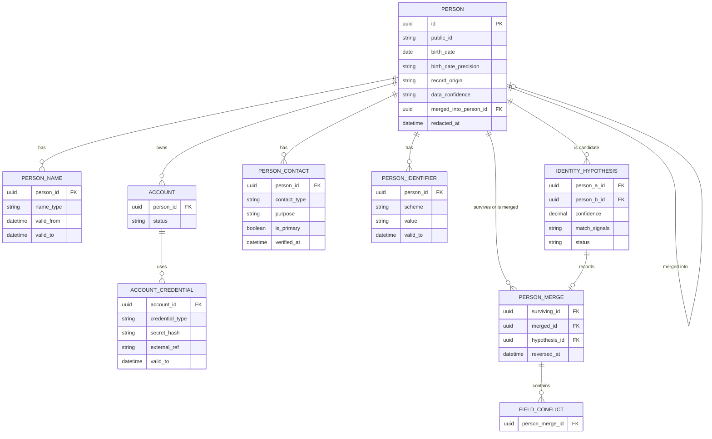
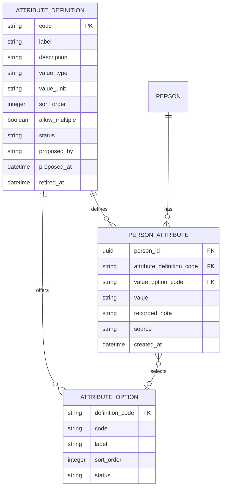
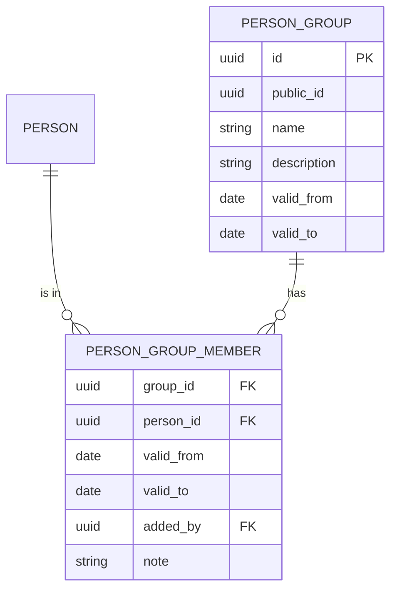
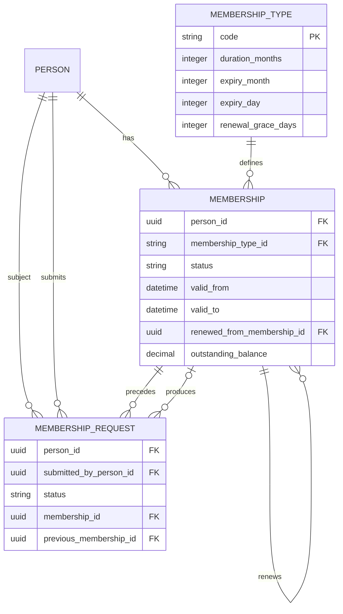
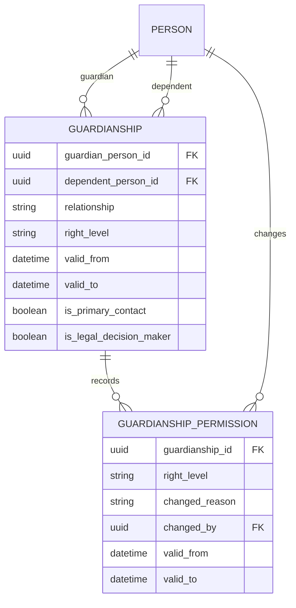
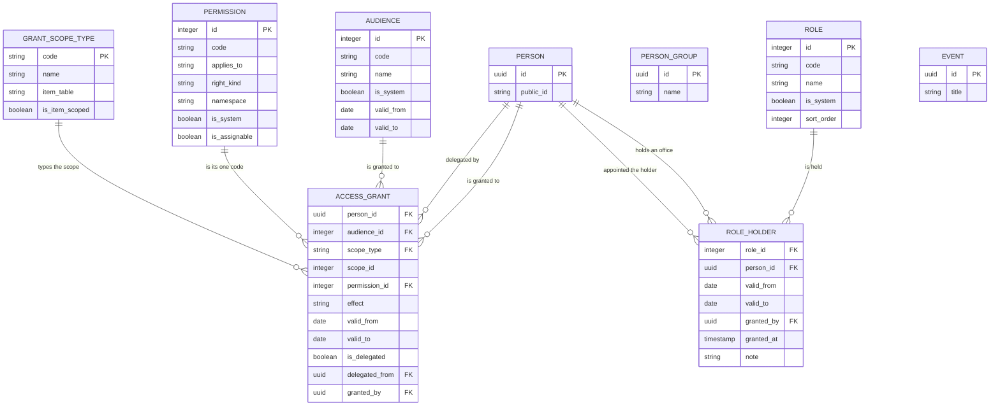
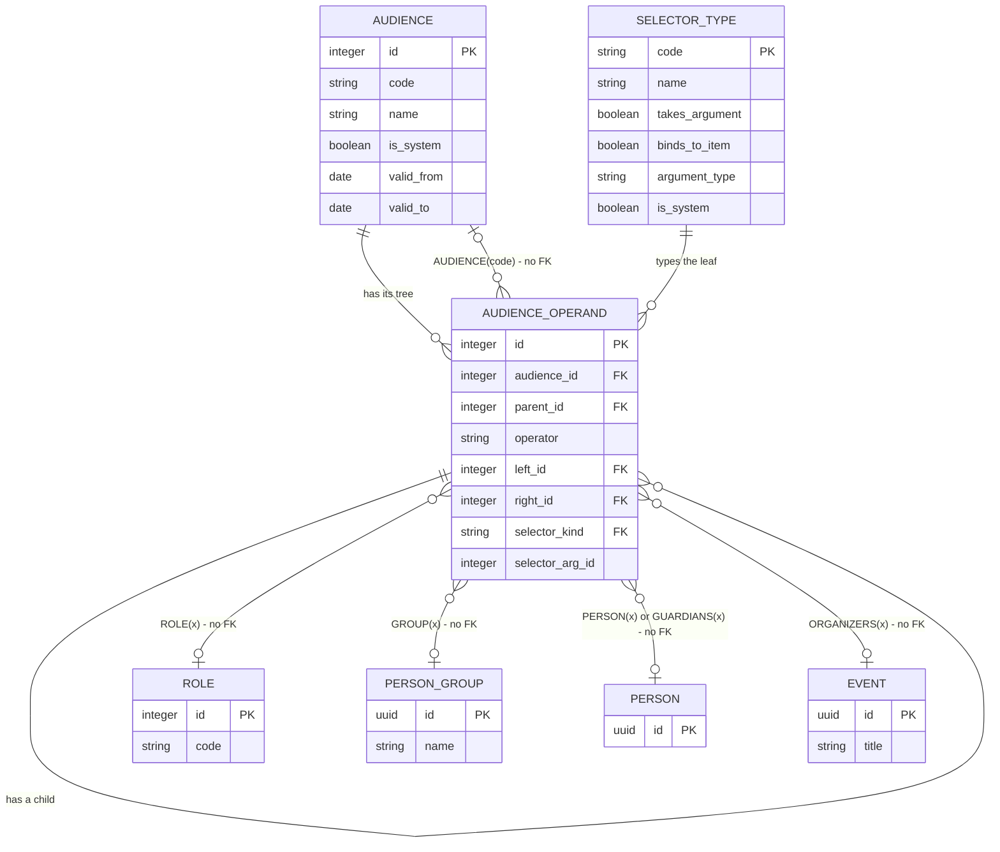
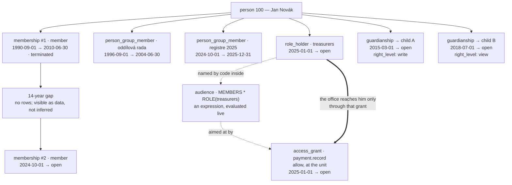

# Appendix — Entity Relationship Diagrams

This appendix describes **relationships** — what points at what, how many, and whether the
link is temporal. Field-level definitions live in the data-model documents, each in the one
that owns the entity, and are deliberately not repeated here.

Diagrams of the schema in [../data-model/00-conventions.md](../data-model/00-conventions.md).
Split by subject area so each
stays readable; the areas connect through `person`, which appears in all of them.

Notation: `→` is a foreign key pointing at the referenced table. `⇒` is a polymorphic
reference (no database-level foreign key). Temporal tables are marked `[T]`.

---

## 1. Identity



**Key point:** everything hangs off `person`, and `person` itself holds only identity.
No status, no role, no membership — everything else the organization records about the human is
the descriptive layer drawn next. See
[../data-model/01-identity.md](../data-model/01-identity.md#1-the-central-claim).

---

## 1a. Personal attributes — everything that is not a name, a gender or an age



**Key point:** these three tables are the whole of what the system knows about a person beyond
name, gender and age. There is no health table beside them and no privileged corner inside them:
[D-083](../decisions/decision-log.md#d-083--there-is-no-medical-record-personal-data-is-one-class-of-data)
removed the category and
[D-084](../decisions/decision-log.md#d-084--descriptive-data-is-organization-defined-at-runtime)
put an organization-maintained vocabulary in its place. Reading is `person.view`, writing is
`person.edit`, and only the vocabulary needs a code of its own
([`attribute.define`](permission-catalog.md#2-people-and-identity)). Fields and rules:
[../data-model/09-attributes.md](../data-model/09-attributes.md).

**None of the three is `[T]`, and the `no` beside them in §7 is a decision, not an omission.** A
`person_attribute` row is **the current belief, overwritten in place**, and `audit_log` holds the
sequence of beliefs, **values included for as long as the payload window lasts — 24 months, after
which the row is reduced and the values are gone**
([D-088](../decisions/decision-log.md#d-088--the-accounting-skeleton-is-permanent-the-audit-trail-is-short))
— which is why the trail is guarded as person data is
([the permission catalog §8](permission-catalog.md#8-audit-and-system)). This corpus gives periods to
things that are true *over an interval* — a membership, an address, an office held, a guardian's
authority — and a descriptive value is not one of
those: it is a statement made now about whatever it is about, with a timestamp on the assertion. A
`valid_from` here would ask a volunteer when an allergy began, which is a question the
organization is not competent to record and has no rule that could use
([D-085](../decisions/decision-log.md#d-085--the-identity-machinery-stays-structured-the-boundary-is-rules-not-sensitivity)).
The cost is named rather than left out: the history of a value lives in the one control
[D-081](../decisions/decision-log.md#d-081--rule-names-survive-the-deletion-of-their-mechanisms-a-renamed-rule-must-say-who-enforces-it-now)
calls the corpus's weakest, and §7 lists it as the accepted risk. It is also a deliberate
departure from `guardianship` two sections below, which keeps its current value *and* its history
in business tables — because authority is asked "what was it on that date?" as a routine part of
answering whether an act was permitted, and an allergy list is not.

The two vocabulary tables are non-temporal for a smaller reason of their own: a code leaves
service by **status**, not by a period, so a value recorded against a retired option keeps meaning
what it meant on the day it was chosen. Retiring therefore never touches a fact — only redacting a
person erases one ([../domain/08-person-data.md](../domain/08-person-data.md#5-forgetting)).

---

## 2. Organization

**There is no organization-structure diagram, because there is no organization structure.** There is one
unit, it is the organization, and it is a **scope** and not a row: `grant_scope_type` carries a code
`unit` with `is_item_scoped = false`, and a grant written at it has no `scope_id`
([D-097](../decisions/decision-log.md#d-097--there-are-no-sub-units-the-unit-is-a-scope-not-a-row)).
What this section drew until round 10 was a hierarchy of bodies with a vocabulary of types, rename
history, lineage edges, rosters and offices. Every one of those tables is deleted, not moved; the ledger
of what each took with it is
[../data-model/02-organization.md §5](../data-model/02-organization.md#5-what-this-page-held-before-round-10).
What is left for this section to draw is the group — a set of people, not a body.



**Key point:** a group is a named set of people with a lifetime, and that is the whole of it — no parent,
no type, no `code`, no path, no nesting rule, no rename history, no split or merger edge, no leadership,
no roles, no fee ([D-098](../decisions/decision-log.md#d-098--a-group-is-a-person_group-explicit-members-a-lifetime-and-no-authority)).
**The member row is dated**, so the roster answers "who was in `schuzka2026-1` on 14 March 2026" from its
own rows rather than from the audit trail, whose payloads expire after 24 months
([D-088](../decisions/decision-log.md#d-088--the-accounting-skeleton-is-permanent-the-audit-trail-is-short)).
No two rows for one person and one group overlap, counted over **all** rows and half-open, so a person who
left in 2020 and came back in 2024 is two rows and never one row edited in place.

**Membership of a group confers nothing.** A set is not a grant; a group member is reached only because
some grant's expression says `GROUP(x)`
([D-005](../decisions/decision-log.md#d-005--permissions-are-grants-never-derived-from-identity)).
The group *is* an item in `grant_scope_type`, so a grant may be written **on** one — that edge is in
[§5a](#5a-authorization--the-tables), not here, because `access_grant` owns it and not this module.
The box is deliberately alone beside its roster: `name` is unique across `role` and `person_group`
together, but no constraint spans two tables, so that is a write-path rule and not a drawn edge
([D-101](../decisions/decision-log.md#d-101--an-audience-is-an-expression-over-named-sets-stored-as-a-tree)).

**Gone from this diagram, one line each, so that a reader hunting for a box finds the decision:**

- ~~`org_unit`~~, ~~`org_unit_type`~~, ~~`org_unit_type_rule`~~, ~~`org_unit_name`~~,
  ~~`org_unit_relationship`~~ — all deleted by
  [D-097](../decisions/decision-log.md#d-097--there-are-no-sub-units-the-unit-is-a-scope-not-a-row), with
  `path`, `depth`, the unit vocabulary, the nesting checks, the rename history and the lineage edges.
  **There is no unit table anywhere in this appendix.** The unit appears once, as the `unit` row of
  `grant_scope_type` ([§5a](#5a-authorization--the-tables)) — a lookup row naming a scope, not a body.
- ~~`unit_participation`~~ — deleted by D-097. `person_group_member` is the roster that outlived it and
  `membership` (§3) is membership of the unit; **the import owes participation rows to nothing**.
- ~~`position`~~, ~~`position_assignment`~~ — deleted by
  [D-100](../decisions/decision-log.md#d-100--a-role-is-an-office-and-a-group-is-company-two-tables-of-the-same-shape):
  with one unit there is no body to be a leader **of**. `is_leadership` and `max_holders` went with them;
  the office survives as `role` + `role_holder` ([§5a](#5a-authorization--the-tables)).
- ~~`org_unit_type.allows_minors`~~ — the flag was deleted by
  [D-095](../decisions/decision-log.md#d-095--units-carry-no-restrictions-joining-one-is-somebody-elses-act)
  and the table that carried it by D-097. *Do not place a child where nobody is responsible* is now
  `person_group.member.manage` held by a named adult, and the system can no longer say which groups are
  for children — that loss is D-095's, restated in D-098.
- ~~`scope_exposure`~~ — deleted by D-097 with the direction-of-authority check and the nightly alert that
  was its only detector. [§5](#5-authorization--the-whole-answer-in-one-diagram) says what was lost with it.

See [../data-model/02-organization.md](../data-model/02-organization.md) and
[../domain/04-organization-structure.md](../domain/04-organization-structure.md); the scope itself is
[../domain/06-authorization-model.md §2](../domain/06-authorization-model.md#2-scopes--the-unit-and-the-item).

---

## 3. Membership



**Four points that matter:**

- `membership_request` has **two** person references:
  `person_id` (the child, who would become a member) and `submitted_by_person_id` (the
  parent, who applied). Collapsing them makes the audit trail false.
- **A request asks for membership of the unit and names nothing else.** `requested_unit_id` is deleted
  with the units
  ([D-097](../decisions/decision-log.md#d-097--there-are-no-sub-units-the-unit-is-a-scope-not-a-row),
  [D-098](../decisions/decision-log.md#d-098--a-group-is-a-person_group-explicit-members-a-lifetime-and-no-authority)),
  and there is therefore no edge from this diagram to any body: which group a new member lands in is a
  write on the group — one `person_group_member` row, §2 — and not a preference on the request. The
  ~~unit this request was aimed at~~ is withdrawn, not moved; the want behind the column is served by the
  free-text `notes` the row already carries.
- **Belonging lives in two shapes now, and neither is a membership.** `person_group_member` (§2) is a
  group's dated roster and is keyed on **person**, never on `membership` — the argument `unit_participation`
  made and [D-098](../decisions/decision-log.md#d-098--a-group-is-a-person_group-explicit-members-a-lifetime-and-no-authority)
  carried over: an imported roster or a 1998 camper has no membership row to point at, and inferring an
  open-ended one would sweep that person into `MEMBERS` today. The table that held it,
  ~~`unit_participation`~~, is deleted by
  [D-097](../decisions/decision-log.md#d-097--there-are-no-sub-units-the-unit-is-a-scope-not-a-row), along
  with the root participation row every membership used to owe. Field rules:
  [../data-model/03-membership.md](../data-model/03-membership.md#5-unit_participation--deleted-by-d-097).
- **`membership_type` exists with exactly one row**, and `category`, `min_age`, `max_age`
  and `requires_background_check` are all gone. Membership is ageless
  ([D-038](../decisions/decision-log.md#d-038--membership-is-ageless)); age is read from
  `person.birth_date` where it matters, which is guardianship — positions carried the last stored
  eligibility rule and [D-100](../decisions/decision-log.md#d-100--a-role-is-an-office-and-a-group-is-company-two-tables-of-the-same-shape)
  deleted it, so age is nobody's check and membership never was one.

---

## 4. Guardianship



**Key point:** guardianship is a general graph — one guardian → many dependents, many
guardians → one dependent, and a person may be both. Authority is per `guardianship` row, and
since [D-074](../decisions/decision-log.md#d-074--a-guardians-rights-are-none-view-or-write-nothing-more-granular)
that row carries one value — `none`, `view` or `write` — so a parent may write one child's
records and only read another's. See
[../data-model/04-relationships.md](../data-model/04-relationships.md).

---

## 5. Authorization — the whole answer in one diagram

```
                     ┌──────────────────────────────┐
                     │          permission          │   'membership.request.approve'
                     │   code · resource · action   │   'event.answer.view'
                     │   applies_to ∈ unit |        │   where a code may be granted at all,
                     │              unit_and_item   │   checked when the GRANT IS SAVED (D-099)
                     │   right_kind ∈ read | write  │   ONE customer: the guardianship channel
                     └──────────────┬───────────────┘   (D-074, given the column by D-099)
                                    │
     one check asks for ONE code. There is no wildcard except 'system.admin' (D-068):
     "can do everything about events" is an OFFICE some grants name, one code per grant.
                                    │
                                    ▼
 ╔═══════════════════════════════════════════════════════════════╗
 ║                         access_grant                          ║  THE ONLY TABLE THAT
 ║  person_id   ─┐  exactly ONE names the grantee: both is       ║  GRANTS (D-005). A grant at
 ║  audience_id ─┘  ambiguous, neither is meaningless            ║  the unit reaches EVERY item
 ║  scope_type ────►  grant_scope_type                           ║  of every type; a grant on
 ║               unit | event | person_group | role | document   ║  one item reaches that item
 ║  scope_id  ⇒ (polymorphic, NO foreign key; ABSENT exactly at  ║  and nothing else (D-099).
 ║               'unit' — that absence IS "the unit is a scope,  ║  There is no middle tier
 ║               not a row")                                     ║  left for anything to
 ║  permission_id ───► permission   (one code, never a bundle)   ║  inherit down.
 ║  effect ∈ allow | deny      DENY IS ABSOLUTE: checked first,  ║
 ║                             scope-independent, beats every    ║  the ladder — revoked 0,
 ║                             allow, no tie-break of any kind   ║  view 10 … admin 40 — is
 ║  valid_from / valid_to [T] · granted_by · revoked_by/_at      ║  deleted, with its rank
 ║  is_delegated · delegated_from  (a delegation must expire)    ║  rule and its locality (D-099)
 ╚═══════════════════════════════════════════════════════════════╝
        ▲ aimed at by id                        ▲ named by code from a leaf (D-103)
        │
   ┌──────────────────────┐                 ┌───────────────────────┐
   │         role         │  an office, and │       audience        │  an EXPRESSION over
   │ code · name ·        │  it confers     │ name · code? ·        │  named sets, stored as a
   │ description ·        │  NOTHING        │ valid_from/[to] [T]   │  tree (D-101) — not a rule
   │ is_system ·          │  by itself:     │ (no kind · no         │  XOR a list XOR an
   │ sort_order           │  the codes an   │  resolver_key · no    │  inclusion (D-091, as
   │ NO period (D-053)    │  office carries │  include_depth_limit  │  amended by D-103; its
   │ NO scope, no         │  are the live   │  · no depth limit)    │  list arm closed by D-105)
   │ requires_member-     │  grants whose   └───────────┬───────────┘
   │ ship (D-100)         │  audience names ├───────────┴──────────────────────────┐
   └──────────┬───────────┘  ROLE(x)        ▼                                      │
              │ dated holders     ┌─────────────────────┐                          │
              ▼                   │  audience_operand   │  hand-written people     │  the audience's
   ┌────────────────────────────┐ │ one row = ONE NODE: │  are PERSON(a) +         │  expression is
   │ person · role ·            │ │ operator + left_id  │  PERSON(b) leaves in     │  evaluated live
   │ valid_from · valid_to ·    │ │  ...or... ONE LEAF: │  the tree — LIST and     │  at the resolver
   │ granted_by · note          │ │ selector_kind +     │  its table are deleted   │  (D-101)
   │ NO scope columns at all:   │ │ selector_arg_id ⇒   │  (D-105), and so are     │
   │ a role is held at the unit │ │ (NO FK — see below) │  their per-person dates  │
   └────────────────────────────┘ └──────────┬──────────┘                          │
                                             │ every leaf is typed by              │
                                             ▼                                     │
                                  ┌─────────────────────────────┐                  │
                                  │        selector_type        │  SEEDED and      │
                                  │ code (a RESERVED word) ·    │  organization-   │
                                  │ takes_argument ·            │  read-only: the  │
                                  │ binds_to_item ·             │  language is data│
                                  │ argument_type · is_system   │  (D-101), not    │
                                  └─────────────────────────────┘  extensible at   │
                                                                   runtime         │
                                                                                   │
   A BOUND operand — the argument-less `PLACED`, `ORGANIZERS`, `CONFIRMED`,        │
   `ATTENDED`, `ON_WAITLIST`, `GUARDIANS` — means "relative to the item being      │
   checked". Legal only on an item-scope grant whose type matches `argument_type`  │
   (`PLACED` on a group grant is refused, `ORGANIZERS` on a unit grant is          │
   refused), and the seeded `event.answer.view` → `ORGANIZERS` is therefore a      │
   TEMPLATE instantiated beside each event row, not one row for every event        │
   (D-102). `OLDER(n)` and `YOUNGER(n)` bind to no item and point at no row:       │
   their argument is an integer — the registry's first non-reference — so          │
   `selector_arg_id` holds a number with nothing behind it: no edge to draw,       │
   nothing for a merge to repoint, nothing for a cascade to find, and the two      │
   reference-less polymorphic keys stay exactly two. Fourteen seeded rows:         │
   five argument tables, one integer, and the operators are still `+ - *`.         │
   `PRESENT(<event>)` is not seeded, and the reason is a consequence: a tick box   │
   on a check-in screen would revoke a leader's access to their own camp when      │
   somebody forgets to tick it. `WHITELISTED` is not seeded either, for want of    │
   any state to evaluate (F-20). Neither is kept out by the language — nothing     │
   in it would refuse either name — both are kept out by what they would do.       │
                                                                                   │
   can(person, permission, scope_type, scope_id, at, about_whom) ── ONE resolver ─ ┘
   ──────────────────────────────────────────────────────────────────────────────
    0  explicit DENY ── absolute and scope-independent. A deny at the unit reaches every
       item of every type; a personal deny beats an audience allow, because this step has
       already returned (D-013 — whose `revoked` LEVEL is now an EFFECT on a grant row).
    1  a live ALLOW at the unit ── reaches every item of every type: after D-097 there is
       no tier between the unit and an item, and after D-102 no owner to ask.
    2  a live ALLOW on this exact item ── exact scope type and id. Nothing precedes it:
       `can_event()` and the unit-authority rule are deleted (D-102).
    3  OWNERSHIP ── the checked person is the actor. Their own row, their own data.
    4  GUARDIANSHIP ── entered by SHAPE (the subject is not the actor), never by a code's
       name; answers with an ALLOW only, when `right_level` covers `permission.right_kind`
       — none covers nothing, view covers `read`, write covers both (D-074, D-079, D-099).
    5  default DENY.
   The allow steps are ALTERNATIVES producing one boolean: their order decides which channel
   the audit names, never what the answer is. **Locality is deleted** — it only ever ordered
   allows against each other, and a boolean has nothing to order (D-099, deleting the second
   half of D-032; the first half is step 0 and is now its entire content).
```

**Key points:**

- **One table grants.** `access_grant` is the only place authority is written, plus the one
  table over a single person, `guardianship_permission` (§4, step 4 above). `role_holder`,
  `person_group_member` and every operand of an audience decide only **whom a grant reaches** —
  being in a set is worth exactly what the grant aimed at that set says
  ([D-005](../decisions/decision-log.md#d-005--permissions-are-grants-never-derived-from-identity),
  restated for roles by
  [D-100](../decisions/decision-log.md#d-100--a-role-is-an-office-and-a-group-is-company-two-tables-of-the-same-shape)).
  ~~`role_assignment` and `access_grant` are the same idea at two granularities, sharing
  `scope_type`, the level model and the resolver~~ — **withdrawn by D-100 and D-099**: `role_holder`
  has no scope columns, no level and no resolver channel, and what the two now share is only the
  temporal shape every dated row has.
- **There is no wildcard permission.** A check for `X.y` needs an exact grant of `X.y`, or
  `system.admin`. The old `<resource>.admin` prefix match was removed with its sixteen codes
  (D-068, reversing D-007); "can do everything about events" is a **role** some grants name, each
  grant naming one of the thirteen `event.*` codes. ~~Note `access_level.admin` (rank 40) is a
  **grant level** and survives — same word, different mechanism~~ — **there is no grant level now**
  ([D-099](../decisions/decision-log.md#d-099--a-grant-allows-or-denies-one-permission-there-is-no-level-and-no-locality)),
  so the collision the sentence existed to warn about cannot occur: `admin` is only ever the code
  `system.admin`.
- **Deny is absolute, and this round quietly upgraded it.** [D-013](../decisions/decision-log.md#d-013--explicit-deny-revoked-is-checked-before-everything)
  said `revoked` beats `deny`, which left an escape hatch — a stale denial could be outranked by a
  newer act, and *revoking* it was a decision somebody could take late. Deleting the ranking deleted
  the hatch: **a live deny now beats every live allow with no tie-break, and the only thing that
  removes one is a person ending its period.** That is why `valid_to` earns its keep on a deny row
  and why *a live deny matching no live allow* is a reported shape rather than a harmless row — a
  deny that denies nothing is how a stale restriction outlives its reason (D-099).
- **The membership gate is deleted, and the posture reversed from default-on to opt-in.**
  ~~The gate sits on the role tier and nowhere else (D-039): no current membership → the role grants
  nothing, unless the role opts out~~, and ~~`system.gate_exempt` waives it for one named person
  (D-051)~~. **Withdrawn by
  [D-100](../decisions/decision-log.md#d-100--a-role-is-an-office-and-a-group-is-company-two-tables-of-the-same-shape)**:
  `MEMBERS` is an operand evaluated live on the checked date, so `MEMBERS * ROLE(x)` gates and
  `ROLE(x)` alone does not, and the "except Honza" case is written inside the same expression.
  The new failure mode is a grant written `ROLE(x)` with no `MEMBERS`, authorizing a lapsed member
  silently and forever, failing closed-looking so nobody notices — the control is a standing report
  of exactly that shape, plus seeded grants that always carry `MEMBERS`. Ownership and guardianship
  were never gated and are untouched.
- **The guardianship channel is entered by shape, not by permission name** ([D-079](../decisions/decision-log.md#d-079--the-guardianship-channel-is-entered-by-shape-not-by-permission-name)):
  the check is about someone other than the actor, and the channel answers with **allows only**. A
  sufficient `right_level` returns true; no row, `none`, or too low a level returns nothing at all
  and the actor's own grants are tried. A prohibition is therefore a `deny` grant, never a low level.
  What the channel compares a permission against is now `permission.right_kind` — a column D-099
  added and names as having exactly one customer, this channel.
- **There is no downward crossing, because there is no down.** ~~Authority never inherits downward;
  a sub-unit's authority reaches outward only through a `scope_exposure` row, written by the sub-unit
  granting coverage over itself~~ — **deleted by
  [D-097](../decisions/decision-log.md#d-097--there-are-no-sub-units-the-unit-is-a-scope-not-a-row)**,
  taking the direction-of-authority check, the `scope.expose` code and the nightly alert that was that
  check's only detector. [D-031](../decisions/decision-log.md#d-031--no-downward-inheritance-of-authority-scope_exposure-is-the-only-crossing)
  was not weakened, it was **deprived of its subject**: with one unit there is no "outside it" to be
  stopped from. What is genuinely lost and reproduced nowhere is the safeguarding property — access to
  a body's children had to be granted **by that body**, by people who recruited the leader and can be
  asked. What remains is a permission held by a named adult, an audit trail whose payloads expire after
  two years, and a report of who holds the write, minus the part where the adult was somebody the body
  chose. A grant at the unit therefore reaches every item of every type, and `system.admin` with it.
- **A grantee may be an audience.** `access_grant.person_id` and `audience_id` are mutually exclusive —
  never both, never neither. An audience is now **an expression over named sets**
  ([D-101](../decisions/decision-log.md#d-101--an-audience-is-an-expression-over-named-sets-stored-as-a-tree)),
  so the old sentence "built-in audiences are rules evaluated at check time; named groups are stored
  lists carrying the stale-group problem knowingly" no longer describes three arms: every operand is
  evaluated live and nothing is stored as a roster — [D-105](../decisions/decision-log.md#d-105--there-are-no-lists-a-hand-written-set-is-an-expression-like-any-other)
  deleted `LIST` and its table, so a hand-written set is `PERSON(a) + PERSON(b)` in the expression —
  and the composition D-091 wanted is an operand instead of an edge. **Author in sets, evaluate per person** — a check compiles to a predicate and never materializes
  a set, and an operand that does not resolve is the **empty set**. That has not moved; what moved in
  round 12 is the wording around it
  ([D-106](../decisions/decision-log.md#d-106--a-failed-operand-stays-the-empty-set-the-missing-half-was-a-report-not-a-refusal)).
  ~~Fail closed in every direction~~ names a volume where there is a direction: **a failed operand on `+`
  or `*` narrows the set, a failed operand on `-` widens it**, so `EVERYONE - PERSON(x)` with a dead `x` is
  fail-closed *and* lockout-everybody in one step rather than a safe state. The failure stays fail-closed
  and stops being silent — an audience carrying a leaf that resolves to nothing is **listed** for its
  owner, in a second column of the report
  [F-21](../open-questions.md#f-21--nothing-bounds-an-audience-expansion-now-who-reads-the-report-of-the-widest-ones)
  already asks for, and no save is refused for it. A person with no birth date is not such a failure: that
  operand resolves perfectly well, and they are simply not in the set.
- **Nothing owns an event** ([D-102](../decisions/decision-log.md#d-102--nothing-owns-an-event-the-people-connected-to-it-are-named-by-selectors-that-bind-to-it)).
  `event.org_unit_id` is deleted, so the people connected to an event are named by operands that bind
  to it — `ORGANIZERS`, `PLACED`, `CONFIRMED`, `ATTENDED`, `ON_WAITLIST` — each a set the item itself
  defines. An operand is a set, not a grant, which is why
  [D-062](../decisions/decision-log.md#d-062--organizers-are-appointed-on-the-event-not-granted)
  ("an `event_organizer` row grants nothing") stands untouched while the resolver stopped
  special-casing it. The consequence worth remembering: a bound operand is illegal at the unit, so
  "every event's answers go to its organizers" is a **template** the event-creation path instantiates
  beside the event row, one per event, in one transaction — and an event whose creation died between
  the two rows has nobody who can read its answers, which is what the *events with no answer-view
  grant* report is for.
- `scope_id` is polymorphic (no FK) so a new grantable item type is a config row, not a
  migration. Accepted cost, with mandatory mitigations.
  [D-101](../decisions/decision-log.md#d-101--an-audience-is-an-expression-over-named-sets-stored-as-a-tree)
  extended the same trade-off, and the same four mitigations, to `audience_operand.selector_arg_id`.

See [../data-model/05-authorization.md](../data-model/05-authorization.md) and
[../domain/06-authorization-model.md](../domain/06-authorization-model.md).

---

## 5a. Authorization — the tables



**Key point:** `access_grant` is a pentagon of references and grants exactly one thing — a grantee
(person **or** audience), a scope, **one** permission, an **effect**, a period
([D-099](../decisions/decision-log.md#d-099--a-grant-allows-or-denies-one-permission-there-is-no-level-and-no-locality)).
Uniqueness follows the shape: at most one live **allow** per grantee, scope **and permission**, with
denies deliberately outside the rule so a deny can sit beside an allow on the same item — that pair is
the only way to say *"this person has the unit's events, except this one"*.

**No line leaves `scope_id`, and that is the diagram telling the truth.** The edge that exists runs to
`grant_scope_type`, the seeded registry (`unit` — the only row with `is_item_scoped = false`, `event`,
`person_group`, `role`, `document` deferred) which is what states which table the unresolved id belongs
to. The id itself is `⇒` polymorphic: no foreign key, validated by the registry plus a nightly orphan
scan per type ([D-011](../decisions/decision-log.md#d-011--scope_id-on-access_grant-is-polymorphic-with-no-foreign-key),
§8). A unit grant carries **no** `scope_id` at all, which is the entire schema-level content of "the unit
is a scope, not a row".

**A role is not a permission bundle.** `role_permission` is deleted by
[D-100](../decisions/decision-log.md#d-100--a-role-is-an-office-and-a-group-is-company-two-tables-of-the-same-shape):
the codes an office carries are the live grant rows whose audience names `ROLE(x)`, so *"what may a
treasurer do?"* is a query over rows a screen can show. `role_holder` is a dated holder row — person,
role, period, who granted it, note — and **names one person, never a rule** ([F-12](../open-questions.md#f-12--closed--may-a-role-be-held-by-a-rule-as-an-audience-is)
is closed with the answer *no*, because an office that cannot answer "who was treasurer in 2023" is not
an office record). `role` itself has no period: it is a definition, valid always, and the period lives on
the holder row ([D-053](../decisions/decision-log.md#d-053--a-role-is-valid-always-only-its-assignment-is-temporal)).
The second arrow into `person` is `granted_by`, and it is drawn to a person because the column records
**who appointed** — a fact carried on the appointment, readable five years later by whoever has to ask.
The **act** of appointing is what `audit_log` holds, with its actor taken from the request context rather
than from the row ([../data-model/06-audit-and-import.md §2](../data-model/06-audit-and-import.md#2-audit_log));
the two are not one column's job, and every other actor column here (`access_grant.granted_by`,
`person_group_member.added_by`) points the same way for the same reason — the third of the three,
`audience_member.added_by`, is gone with its table, and what it used to answer per name is answered
now only by *who last saved the expression* and by `audit_log`
([D-105](../decisions/decision-log.md#d-105--there-are-no-lists-a-hand-written-set-is-an-expression-like-any-other)).

**Names are one namespace.** `role.code`, `person_group.name` and a set `audience.code` are unique
**together**, case- and separator-folded, and every `selector_type.code` is reserved — so a group called
`MEMBERS` is refused at the save rather than discovered later as an expression whose meaning moved. No
constraint spans three tables, so the write path carries the rule and an integrity check asserts the
write path still does
([D-101](../decisions/decision-log.md#d-101--an-audience-is-an-expression-over-named-sets-stored-as-a-tree),
[D-103](../decisions/decision-log.md#d-103--an-audience-may-name-another-audience),
[D-081](../decisions/decision-log.md#d-081--rule-names-survive-the-deletion-of-their-mechanisms-a-renamed-rule-must-say-who-enforces-it-now)).
What is stored is always kind + id, so a rename never rewrites a grant.

---

## 5b. The audience expression

The rows of one audience's expression tree. The audience **is** the tree; `audience_operand` holds its
nodes and leaves, one row each.



**Five of these lines are `⇒` in the notation above, and not one of them is a foreign key.** A leaf's
`selector_arg_id` is one
integer column pointing at `role`, `person_group`, `audience`, `person` or `event` depending on
`selector_kind` — the same polymorphism, the same four mandatory mitigations and the same nightly orphan
scan that `access_grant.scope_id` already accepted
([D-011](../decisions/decision-log.md#d-011--scope_id-on-access_grant-is-polymorphic-with-no-foreign-key),
carried over by
[D-101](../decisions/decision-log.md#d-101--an-audience-is-an-expression-over-named-sets-stored-as-a-tree)).
Drawing it as five real edges would be the lie; drawing it as no edges at all would hide the fan. The
registry is what resolves the ambiguity, and it is a real edge: `selector_type` says whether the code
takes an argument, whether the **argument-less** form binds to the item being checked, and what type the
argument is — the parser reads its reserved words from that table, the editor builds its dropdown from
it, and the save path checks arity against it
([D-101](../decisions/decision-log.md#d-101--an-audience-is-an-expression-over-named-sets-stored-as-a-tree)).
It is seeded, every row `is_system`, and **organization-read-only**: "the language becomes data" has
never meant the language is extensible at runtime, and a seeded code with no shipped evaluator arm is a
deployment bug that surfaces as an empty set — which is why the registry holds no row waiting to be
implemented.

**`argument_type` has six values and five of them are tables.** `OLDER` and `YOUNGER`
([D-107](../decisions/decision-log.md#d-107--the-grammar-opens-an-attribute-may-be-an-operand-and-the-vocabulary-stays-seeded))
take **an integer — a whole number of years** — so `selector_arg_id` holds `18` for `OLDER(18)`, and this
is the first operand argument in the registry that names no row. **The five drawn edges are still exactly
five, and the count this appendix keeps is unchanged for the right reason rather than by luck**: a scalar
sitting in `selector_arg_id` is not a reference, so there is nothing to repoint when a person is merged,
nothing for a cascade to find, nothing for the orphan scan to walk, and the binding check that compares
`argument_type` against a grant's item type simply does not apply to an operand that binds to no item.
**There are still exactly two reference-less polymorphic keys** — `access_grant.scope_id` and
`audience_operand.selector_arg_id` — and `18` is not one of them, because the check is about references
(§8). The two operands read `person.birth_date` **as of the date being checked**, which is why they are a
registry row and nothing more: they are ordinary named operands, composed by `+ - *` like every other, and
the set they name changes with no write at all.

**No leaf resolves to anything but people, and that is why there is no `GRANTS(…)`.** An operand resolves
to a **set of people**, because a set of people is what a grantee is; a set of *grants* is a filter over
the grant list, and "these twenty rows, now also for that office" is something an editor does while
finding the rows to act on, not something a stored grantee could ever be evaluated against. The bulk
operation stays an affordance over the list, and the registry refuses the kind rather than leaving it
unimplemented
([D-101](../decisions/decision-log.md#d-101--an-audience-is-an-expression-over-named-sets-stored-as-a-tree)).

**One row is one node or one leaf, never both.** A node carries `operator` (`+` union, `*` intersection,
`-` difference) with `left_id` and `right_id`, which are **not** interchangeable because `-` is not
commutative; a leaf carries `selector_kind` and, where the registry says so, `selector_arg_id`.
`parent_id` lives **on the child**, so a node belongs to exactly one expression and a sharing table is
refused — editing a shared node would silently widen every grant using it. `audience_id` is
denormalized onto every row so the read path fetches one audience's rows in one indexed read and
assembles the tree in memory; it never walks a parent chain
([D-101](../decisions/decision-log.md#d-101--an-audience-is-an-expression-over-named-sets-stored-as-a-tree)).
**Round 12 changed nothing in this paragraph.** `OLDER` and `YOUNGER` arrived as two seeded rows of the
registry and not as anything here: the operator enum is still `+ - *`, no node kind was added, no column
was added, and `(MEMBERS * OLDER(18)) - YOUNGER(6)` is stored as the same node and leaf shapes that
already existed — a `*` node with a `MEMBERS` leaf and an `OLDER` leaf, under a `-` node whose right
operand is a `YOUNGER` leaf ([D-107](../decisions/decision-log.md#d-107--the-grammar-opens-an-attribute-may-be-an-operand-and-the-vocabulary-stays-seeded)).

**`AUDIENCE(code)` is the leaf that points back into this diagram**
([D-103](../decisions/decision-log.md#d-103--an-audience-may-name-another-audience)): it names another
saved audience **by its `code`**, which is why `code` exists and is optional, and why an unnamed audience
is simply not composable. The `AUDIENCE` leaves *are* the reference edges — there is no `audience_include`
table, so "does this cycle", "how deep", "which grants name this audience" and "may I end it" are all one
indexed query over `selector_kind = 'AUDIENCE'` rows. One sentence of D-101 is false and stays struck:
~~a tree cannot cycle, so the only acyclicity guard left is the cheap parent-chain one~~ — true of one
tree, false of a **forest of trees pointing at each other**, so the save-time reachability walk is back
— inside the tree, and across audiences through every `AUDIENCE(x)` leaf — and
[D-105](../decisions/decision-log.md#d-105--there-are-no-lists-a-hand-written-set-is-an-expression-like-any-other)
deleted `selector_depth_limit` and left those two cycle walks as the only structural guard there is.
It walks for cycles and nothing else: the tree is stored exactly as the writer wrote it, with no
depth bound and no rebalancing, and the standing report of the widest and deepest audiences is a
convention, not a guard ([D-081](../decisions/decision-log.md#d-081--rule-names-survive-the-deletion-of-their-mechanisms-a-renamed-rule-must-say-who-enforces-it-now)).
The protection that keeps the dangerous
case out is that an audience named by a live grant may not be ended or deleted while that grant lives:
under `-`, an emptied operand makes the answer **wider**.

**`audience_member` is deleted, and `LIST` with it**
([D-105](../decisions/decision-log.md#d-105--there-are-no-lists-a-hand-written-set-is-an-expression-like-any-other)).
A hand-written set of people is now written where every other set is written — in the expression, as
`PERSON(a) + PERSON(b)` — and what the table carried that the tree does not is written as lost, not as
managed: **no per-person dates** (a person is in the audience or not; a June-to-August exception is a
second grant with its own period, which is what
[D-099](../decisions/decision-log.md#d-099--a-grant-allows-or-denies-one-permission-there-is-no-level-and-no-locality)'s
shape is for), and no *who added this person* beyond *who last saved the tree*. The reason it was never
merged into `GROUP(x)` survives the table unchanged: a group's members are the organization's record
and are true with no grant pointing at them, while a name written into an expression is meaningless
outside the expression it completes
([D-098](../decisions/decision-log.md#d-098--a-group-is-a-person_group-explicit-members-a-lifetime-and-no-authority)).
Naming people inside a grant must not make them group members: `(GROUP(kitchen) + LIST) - PERSON(a)`
becomes `(GROUP(kitchen) + PERSON(honza)) - PERSON(a)` — same meaning, one fewer kind of thing — and
merging the two would still make the permission table the system's roster.

**`PERSON(x)` is drawn as the `person` argument edge, and it was the thirteenth seeded `selector_type`
row added — with `LIST` deleted it was one of the twelve that remained, and it is one of the fourteen
seeded today, `OLDER` and `YOUNGER` having arrived in round 12
([D-107](../decisions/decision-log.md#d-107--the-grammar-opens-an-attribute-may-be-an-operand-and-the-vocabulary-stays-seeded)).**
It got there late and by an odd route: D-101's grammar and D-100's exemption table both wrote `PERSON(y)`
from the start, the registry was written from the evaluator's arm list instead, and the two disagreed for a
whole round without any check noticing
([D-104](../decisions/decision-log.md#d-104--a-permission-codes-last-segment-is-an-action-and-a-registry-that-prose-contradicts-is-a-fiction)).
`GUARDIANS(x)` takes a person argument either way, so the storage was never the disputed part —
`selector_arg_id` may hold a person id per
[D-011](../decisions/decision-log.md#d-011--scope_id-on-access_grant-is-polymorphic-with-no-foreign-key) —
which is why this appendix drew the edge while the language was still being argued about. What the row adds
over that storage fact is one fact of meaning: **an expression may name a single human who is on nobody's
roster** — and since a hand-written set is a sum of these
([D-105](../decisions/decision-log.md#d-105--there-are-no-lists-a-hand-written-set-is-an-expression-like-any-other)),
the edge is load-bearing: every hand-named person in the system is now a `selector_arg_id` with
deliberately no foreign key, so a merge or a redaction must repoint every leaf that names the absorbed
person, and the nightly orphan scan is the backstop rather than the mechanism. `PERSON`, `GUARDIANS`,
`ROLE`, `GROUP` and `AUDIENCE` are the five codes whose argument names a
person, an office, a group or another audience. The fifth drawn edge, to `event`, belongs to the
item-bound codes — `ORGANIZERS`, `PLACED`, `CONFIRMED`, `ATTENDED`, `ON_WAITLIST` — whose argument is
optional exactly because the item being checked usually supplies it
([D-102](../decisions/decision-log.md#d-102--nothing-owns-an-event-the-people-connected-to-it-are-named-by-selectors-that-bind-to-it)).

See [../data-model/05-authorization.md §8](../data-model/05-authorization.md#8-audience--grants-that-target-a-set-of-people)
and [../domain/06-authorization-model.md §6](../domain/06-authorization-model.md#6-the-resolver).

---

## 6. Temporal pattern, illustrated

Every `[T]` table above uses the same shape. The returning-member case shows why:



Note the two membership rows have the **same type**. They differ only in period and end
reason — this person was a member twice, and was a child and then an adult throughout. The
old diagram called them `child` and `adult`; that was the framing the ageless decision
replaced ([D-038](../decisions/decision-log.md#d-038--membership-is-ageless)).

**Where the first row came from is not drawn, and the answer moved twice this round.** A 1990s roster row
states a period of membership, and since
[D-093](../decisions/decision-log.md#d-093--the-one-off-import-may-create-memberships-both-ends-dated) one
reviewed batch may turn that stated period into membership #1 itself: both ends dated, `data_confidence`
low, the batch id on it, **no** `fee_obligation` and a balance that stays absent rather than zero, because
the corpus carries no money in it
([D-090](../decisions/decision-log.md#d-090--the-legacy-corpus-is-thousands-of-roster-rows-with-numbers-and-no-money)).
Two shapes remain forbidden, and they are the two the ban was ever really about: an **open-ended** imported
membership, and one **inferred from an attendance row**. A closed period gates nothing in the present; an
open one hands authority to whoever signs up under that name tomorrow. What the pipeline no longer
produces at all is the second row of this diagram's previous version: the participation rows it owed
beside every membership went with the unit hierarchy
([D-097](../decisions/decision-log.md#d-097--there-are-no-sub-units-the-unit-is-a-scope-not-a-row)), so a
people batch writes the membership and nothing else, and the group rows are written by somebody who knows
the group exists
([../domain/03-identity-and-legacy.md §7](../domain/03-identity-and-legacy.md#7-legacy-import-pipeline)).

Questions this shape supports, all of which fail against a design with `person.is_member`:

- Was this person a member on 1998-06-01?
- How many years of membership, excluding the gap?
- Which groups was he in during 2003? — `person_group_member` answers it, because those rows are dated
  rather than derived from a rule that could change its mind.
- Who held the office of `treasurers` in 2023? — the same shape of answer, one `role_holder` row, which is
  the reason [F-12](../open-questions.md#f-12--closed--may-a-role-be-held-by-a-rule-as-an-audience-is) was closed
  with the answer *no*.
- Would that grant have reached him on that date? — holder row, expression and grant are all evaluated as
  of the same `at`, and none of the three may be stored as a materialized list
  ([D-101](../decisions/decision-log.md#d-101--an-audience-is-an-expression-over-named-sets-stored-as-a-tree)).
- How old were they when they joined the second time? — answered from `person.birth_date`,
  which the membership rows never copy.
- Who are the returning members — more than one membership with a gap between?

Every one of them is answered as of a date, and an as-of date must be applied to every join in
the answer, not only to the first one — a period joined without it leaks the present into the
past. That is what the `[T]` marking on the tables above exists to make visible.

---

## 7. Table inventory

One entry per entity: what it is, what it references, how many may exist, and whether it is
temporal. `⇒` marks a polymorphic reference with no foreign key. Entries that exist **only** to
join two other entities say so. An entity that no longer exists keeps its row, **struck**, in the block
a reader would have looked for it in, with the decision that deleted it — and its `Points at` and
`How many` cells are empty, because there is nothing left to point at and no rule left to count.

**Read the `[T]` column as a decision, not a default.** A `no` is normally a lookup table, a
definition, or an append-only trail — the kinds of thing that have no period to carry. Exactly one
`no` in this inventory is a choice about a person's data rather than a lack of one:
`person_attribute`, and the reason is written out under its own block below and in §1a.

**Identity**

| Entity | What it is | Points at | How many | [T] |
|---|---|---|---|---|
| `person` | The human being. Holds identity only — no status, no role, no membership | Nothing, except itself: `merged_into_person_id` ⇒ self | One per human, effectively; a merged row survives as a tombstone and is never deleted. The pointer is **never rewritten forward** when the survivor is itself absorbed, so chains persist and `resolve_person()` walks them ([D-087](../decisions/decision-log.md#d-087--merge-chains-stay-because-reversing-a-merge-is-a-supported-operation)) | no |
| `person_name` | One name a person has had, and when | `person` | Many per person; one current row per `name_type` | yes |
| `account` | The ability to log in. Optional, and independent of membership | `person` | Zero or many per person over a lifetime; at most one **live** row | no |
| `account_credential` | One authentication method's secret or external handle | `account` — deliberately not `person` | Many per account; one current row per external issuer and reference pair | yes |
| `person_contact` | An email, phone or postal address, as a dated row rather than a column | `person` | Many per person; one current primary per type and purpose | yes |
| `person_identifier` | An identifier issued outside the system | `person`; `identifier_scheme` for its `scheme` | Many per person; `(scheme, value)` unique among current rows | yes |
| `identifier_scheme` | The vocabulary of identifier schemes | Nothing | Lookup table, one row per scheme | no |
| `identity_hypothesis` | A *proposal* that two person rows are the same human | `person` twice; the reviewer is a `person` | At most one live hypothesis per pair; a rejected pair may be re-proposed | no |
| `person_merge` | The record that one row was absorbed into another, and how to undo it | `person` twice; `identity_hypothesis`, optional | One per merge performed; a reversal is recorded on the same row | no |
| `field_conflict` | One value a merge could not decide between two candidates — raised for either half of the record, an identity field or a descriptive value ([§1a](#1a-personal-attributes--everything-that-is-not-a-name-a-gender-or-an-age)) | `person_merge`; `⇒ (entity_table, entity_id)` — polymorphic by nature | Many per merge | no |

**Personal attributes** — everything known about a person other than name, gender and age
([§1a](#1a-personal-attributes--everything-that-is-not-a-name-a-gender-or-an-age))

| Entity | What it is | Points at | How many | [T] |
|---|---|---|---|---|
| `attribute_definition` | One thing the organization collects about people: the code, its label, its type, and whether several values may be current at once | Nothing | One code per **normalized** spelling — `Allergy` and `allergy ` are one row; statuses `proposed`, `live`, `retired`, and retiring keeps the row and its values | no |
| `attribute_option` | One allowed value of a `one_of` definition | `attribute_definition` | One row per code per definition; a retired option is never re-meaning, because values stored against it are historical facts | no |
| `person_attribute` | The value one person currently has for one code | `person`, `attribute_definition`, and `attribute_option` when the type is `one_of` | One current row per person and code; more only where the definition sets `allow_multiple`, which no constraint can check (it reads another table) | **no — deliberately** |

**That last `no` is the decision, and it is the reason this row spells it out.** Values are
overwritten in place and `audit_log` — carrying the values themselves, **for 24 months** — is the only
history. This is the one place in the schema where *"what did we believe in 2019?"* would be answered
from the trail rather than from business data, and since round 8 the answer is that **it is answered
for two years and not beyond** ([D-088](../decisions/decision-log.md#d-088--the-accounting-skeleton-is-permanent-the-audit-trail-is-short)):
the honest description of this trade is *no long history*, not merely *no temporal columns*, and if a
case ever needs the long version the fix is temporal values — D-085 reversed — not a longer trail.
On top of that expiry sits the older caveat:
[D-081](../decisions/decision-log.md#d-081--rule-names-survive-the-deletion-of-their-mechanisms-a-renamed-rule-must-say-who-enforces-it-now)
records the trail as discipline rather than guarantee. The trade was made with that in view and is
reversible in one entry
([D-085](../decisions/decision-log.md#d-085--the-identity-machinery-stays-structured-the-boundary-is-rules-not-sensitivity),
[../data-model/09-attributes.md §3](../data-model/09-attributes.md#3-person_attribute--a-value-one-person-has)).
The two vocabulary tables carry **status instead of periods**, which is what lets a code be retired
without touching a fact; only redacting a person erases values, and a redacted person still holding
attribute rows, or still having their values readable in the trail, means the redaction did not happen
([../data-model/09-attributes.md §8](../data-model/09-attributes.md#8-integrity-checks)).

**Groups and offices** — what the organization module holds now ([§2](#2-organization)), plus the two
office tables it shares with authorization, drawn in [§5a](#5a-authorization--the-tables) and specified in
[../data-model/05-authorization.md §3](../data-model/05-authorization.md#3-role--an-office)
and [§4](../data-model/05-authorization.md#4-role_holder--who-holds-an-office)

| Entity | What it is | Points at | How many | [T] |
|---|---|---|---|---|
| `person_group` | A named set of people with a lifetime — a crew, a registration team, everyone who ever ran the camp. **Confers nothing**: authority arrives only through a grant aimed at the group | Nothing. Its `name` is unique **together with** `role.code` and a set audience's `code`, which no constraint can express, so the write path carries the rule and an integrity check asserts the write path still does | One row per name. Ended by `valid_to`, never deleted while member rows exist, and **ending** it is refused while a live grant — or a live audience reachable from one — names it, because `EVERYONE - GROUP(x)` with an emptied group denies everybody | yes |
| `person_group_member` | Join entity: this person was in this group for that period. Written by a person, never derived from a rule | `person_group`; `person` — **`person`, not `membership`**, so a 1998 roster row does not have to invent a membership in order to be true; and `person` as the one who added them | Many per group at once; **no overlapping periods for one person in one group, over all rows** including ended ones, which the write path enforces ([../data-model/02-organization.md §2](../data-model/02-organization.md#2-person_group_member)) | yes |
| `role` | An office — `treasurers`, `registrar`, `counselors`. A definition, valid always; the period lives on the holder row. **It carries no permissions and confers nothing:** the codes an office holds are the live grants whose audience names `ROLE(x)` | Nothing. Its `code` joins the same one namespace as group names, and every reserved `selector_type.code` is refused against it | One row per `code`; deleting one is refused while holder rows exist, so an office cannot be emptied in one save | no |
| `role_holder` | Who holds an office for what period — **one named person, never a rule**: [F-12](../open-questions.md#f-12--closed--may-a-role-be-held-by-a-rule-as-an-audience-is) was closed by D-100 with the answer *no*, because an office record that cannot answer "who held this in 2023" is not one | `role`; `person` twice — the holder, and the person who appointed them | At most one **open** row per person and role; no overlap over all rows; nothing forces a row to end, and the standing report is the control ([D-071](../decisions/decision-log.md#d-071--nothing-forces-a-role-assignment-to-end-the-gate-and-the-report-are-the-control)) | yes |
| ~~`org_unit`~~ | ~~A unit — the root, or anything nested beneath it to any depth.~~ **Deleted by [D-097](../decisions/decision-log.md#d-097--there-are-no-sub-units-the-unit-is-a-scope-not-a-row)**: there are no sub-units, and the unit is one row of `grant_scope_type` rather than a row of its own table | — | — | — |
| ~~`org_unit_type`~~, ~~`org_unit_type_rule`~~ | ~~The organization's vocabulary of kinds of unit, and which kind may sit under which.~~ Deleted by the same decision; the shape of the organization is now nobody's data, and no group table replaces it | — | — | — |
| ~~`org_unit_name`~~ | ~~One name or code a unit carried, with the period it was carried in.~~ Deleted by D-097, and nothing replaces it: a group is named by one column, so a rename loses the old name — the recorded cost in [../data-model/02-organization.md §5](../data-model/02-organization.md#5-what-this-page-held-before-round-10) | — | — | — |
| ~~`org_unit_relationship`~~ | ~~A typed lineage between two units — `split_from`, `merged_into`, `successor_of`.~~ Deleted by D-097; [D-098](../decisions/decision-log.md#d-098--a-group-is-a-person_group-explicit-members-a-lifetime-and-no-authority) refuses group-to-group edges outright, so continuity is prose on a group's row | — | — | — |
| ~~`position`~~, ~~`position_assignment`~~ | ~~A defined slot in a kind of unit, and a person filling it.~~ Deleted by [D-100](../decisions/decision-log.md#d-100--a-role-is-an-office-and-a-group-is-company-two-tables-of-the-same-shape): an office that had to be filled before it meant anything was a second way to hold authority, and `role_holder` is the one way now | — | — | — |

**Membership**

| Entity | What it is | Points at | How many | [T] |
|---|---|---|---|---|
| `membership_type` | The fee and renewal parameters. One row, `member`, kept as a table so the vocabulary can grow | Nothing | Exactly one row today (D-037) | yes |
| `membership` | One period of membership, with its own ending | `person`, `membership_type`; itself via `renewed_from_membership_id` | Many per person over a lifetime; **one open at a time, ever** | yes |
| `membership_request` | An application. Two person references on purpose: the subject and the submitter | `person` twice, `membership_type`, and `membership` twice (what it produced, what it renews). **No unit**: `requested_unit_id` is deleted by [D-098](../decisions/decision-log.md#d-098--a-group-is-a-person_group-explicit-members-a-lifetime-and-no-authority) — a request asks for membership of the unit and names nothing else, because which group a new member joins is somebody's act afterwards, not a term of the application | At most one **open** request per person | no |
| ~~`unit_participation`~~ | ~~Belonging to one unit — the root's mirror of a membership, or a sub-unit's roster.~~ **Deleted by [D-097](../decisions/decision-log.md#d-097--there-are-no-sub-units-the-unit-is-a-scope-not-a-row)**, which also removed the obligation to open a root row beside every membership. It had itself been renamed from `unit_membership` by [D-041](../decisions/decision-log.md#d-041--belonging-to-a-sub-unit-is-a-participation-record-not-a-membership); `person_group_member` is the dated roster that outlived it | — | — | — |

**Relationships**

| Entity | What it is | Points at | How many | [T] |
|---|---|---|---|---|
| `guardianship` | One adult's responsibility for one dependent, carrying one `right_level` | `person` twice — never the same person twice | One current row per pair; unlimited past rows; a dependent may have any number of guardians at once | yes |
| `guardianship_permission` | The temporal history of that row's right level — not a capability list since D-074 | `guardianship` | Exactly one open row per guardianship; its value is what `guardianship.right_level` copies | yes |

**Authorization** — the tables are drawn in [§5a](#5a-authorization--the-tables) and the expression in
[§5b](#5b-the-audience-expression)

| Entity | What it is | Points at | How many | [T] |
|---|---|---|---|---|
| `permission` | One coded capability — the only thing a check asks for, and a grant names exactly one | Nothing | One row per code; the code never changes. `applies_to` says whether the code may be granted at the unit or **also** on an item, checked when the grant is saved; `right_kind` exists for exactly one customer, the guardianship channel ([D-099](../decisions/decision-log.md#d-099--a-grant-allows-or-denies-one-permission-there-is-no-level-and-no-locality)) | no |
| `grant_scope_type` | The registry of things a grant may be written on, and the table its id lives in. **`unit` is its only non-item row** — which is where the unit now lives | Nothing | One row per scope kind: `unit`, `event`, `person_group`, `role`, and `document` deferred. Adding a grantable thing is a row here rather than a migration | no |
| `access_grant` | **The only table that grants.** A grantee, a scope, one permission, an effect, a period | `person` **or** `audience`, never both; `grant_scope_type` and `⇒ scope_id`, absent exactly at `unit`; `permission`; `person` as grantor, delegator and revoker | At most one live **allow** per grantee, scope **and permission** — denies sit outside the rule on purpose, because allow-beside-deny is the only way to say *"the unit's events, except this one"*; a delegation must carry an end date | yes |
| `audience` | A set of people a grant may name — **an expression over named sets, stored as a tree** ([D-101](../decisions/decision-log.md#d-101--an-audience-is-an-expression-over-named-sets-stored-as-a-tree)), not a rule XOR a list XOR an inclusion | Its own operand rows; `code` is optional and is the only thing another audience may name ([D-103](../decisions/decision-log.md#d-103--an-audience-may-name-another-audience)); `resolver_key`, `scope_parameter`, `include_depth_limit` and `selector_depth_limit` are deleted, the last of them by [D-105](../decisions/decision-log.md#d-105--there-are-no-lists-a-hand-written-set-is-an-expression-like-any-other) | One row per audience; the tree is stored exactly as the writer wrote it and its height is bounded by nothing — the save-time cycle walks are the only structural guard, and the standing report of the widest and deepest audiences is a convention, not a guard ([D-081](../decisions/decision-log.md#d-081--rule-names-survive-the-deletion-of-their-mechanisms-a-renamed-rule-must-say-who-enforces-it-now)); an ended audience reaches nobody, so ending one is refused while a live grant names it | yes |
| `audience_operand` | Join entity: **one row of one audience's expression tree** — a node (`operator`, `left_id`, `right_id`) or a leaf (`selector_kind`, `⇒ selector_arg_id`), never both | `audience`, denormalized onto every row so one audience's tree is one indexed fetch; itself, `parent_id` on the child; `selector_type`; and `⇒` a `role`, `person_group`, `audience`, `person` or `event` **with no foreign key** — [D-011](../decisions/decision-log.md#d-011--scope_id-on-access_grant-is-polymorphic-with-no-foreign-key)'s accepted trade-off, extended by D-101 | One row per node or leaf; a node never belongs to another audience than its parent's; the forest is acyclic, checked on save | no |
| `selector_type` | The registry of operands the language has: the reserved word, whether it takes an argument, whether its argument-less form binds to the item being checked, and what type the argument names | Nothing | **Fourteen** seeded rows: eleven from the evaluator's arm list, `PERSON` as the thirteenth to arrive, `LIST` gone in between ([D-105](../decisions/decision-log.md#d-105--there-are-no-lists-a-hand-written-set-is-an-expression-like-any-other)), and `OLDER` and `YOUNGER` added in round 12 ([D-107](../decisions/decision-log.md#d-107--the-grammar-opens-an-attribute-may-be-an-operand-and-the-vocabulary-stays-seeded)) — the first two whose `argument_type` is a whole number of years and not a table, and the first two whose membership changes with no write, because they read `person.birth_date` on the checked date. Six `argument_type` values, five of them tables; the operators stay `+ - *`. Every row `is_system` and organization-read-only, and every row both seeded and shipped — a code with no evaluator arm is a deployment bug, not a held feature ([D-104](../decisions/decision-log.md#d-104--a-permission-codes-last-segment-is-an-action-and-a-registry-that-prose-contradicts-is-a-fiction)) | no |
| ~~`audience_member`~~ | ~~The `LIST` leaf: this audience's own hand-typed list of people — the only operand that was not a rule about anybody.~~ **Deleted by [D-105](../decisions/decision-log.md#d-105--there-are-no-lists-a-hand-written-set-is-an-expression-like-any-other)**, `LIST` and its seed row with it: a hand-written set is now `PERSON(a) + PERSON(b)` in the expression, with no per-person dates — a time-windowed exception is a second grant with its own period. The refusal to merge names into a group survives the table: a `PERSON(x)` leaf is not a `GROUP(x)` because merging them would make the permission table the system's roster | — | — | — |
| `access_log` | The audit trail — who did what, by what authority, with what result | `person` as actor and as subject; `⇒ authorization_ref_id` naming `access_grant` **or** `guardianship_permission` — `role` and `system` are gone from the channel enum, so an old row reading `role` is unreadable by this model on purpose ([D-100](../decisions/decision-log.md#d-100--a-role-is-an-office-and-a-group-is-company-two-tables-of-the-same-shape)); `⇒ entity_id` | Append-only today; **proposed** to take the same 24-month window as the audit payload, which would make this cell wrong as written — **F-8**, unconfirmed ([D-088](../decisions/decision-log.md#d-088--the-accounting-skeleton-is-permanent-the-audit-trail-is-short)) | no |
| `permission_cache` | A computed answer kept briefly so checks are cheap | `person`, plus the code and scope it answers for; the operand cache beside it is keyed per person, selector kind, argument and item | One row per person, code, scope type and scope id, each with an expiry. Derived and disposable — never a source of truth | no |
| ~~`role_permission`~~ | ~~Join entity: this role carries this permission, and nothing else.~~ Deleted by D-100: the codes an office holds are the live grants naming `ROLE(x)`, so the bundle is a query a screen can show rather than a table | — | — | — |
| ~~`role_assignment`~~ | ~~Authority held for a period over a scope.~~ Deleted by D-100 and replaced by `role_holder`, which keeps the person and the period and drops the scope columns, the level and the resolver channel | — | — | — |
| ~~`scope_exposure`~~ | ~~A unit granting one named assignment coverage over itself — the only downward crossing.~~ Deleted by D-097 together with the direction-of-authority check it existed to serve, which had no detector but this table's own alert | — | — | — |
| ~~`access_level`~~ | ~~The ordered ladder `revoked`, `view`, `contribute`, `manage`, `admin`, compared by rank.~~ Deleted by [D-099](../decisions/decision-log.md#d-099--a-grant-allows-or-denies-one-permission-there-is-no-level-and-no-locality): the answer is one boolean, `revoked` survives as `effect = 'deny'` on a grant row, and `admin` survives only as the permission code `system.admin` | — | — | — |
| ~~`permission_level`~~ | ~~Join entity: this permission needs this level on this kind of scope.~~ Deleted by D-099. The one question it still answered — may this code be granted on an item at all — is `permission.applies_to` now | — | — | — |
| ~~`audience_include`~~ | ~~Join entity: this group includes that group, to a depth limit.~~ Deleted by D-101; an `AUDIENCE(code)` leaf is the edge now, which is also what put the cycle check back on the save path ([D-103](../decisions/decision-log.md#d-103--an-audience-may-name-another-audience)) | — | — | — |

`role` and `role_holder` are inventoried under **Groups and offices** above, where the module keeps them;
both are drawn in the authorization diagram, because that is where a reader meets what they do — which is
nothing at all, on their own.

**Audit and import**

| Entity | What it is | Points at | How many | [T] |
|---|---|---|---|---|
| `audit_log` | The row-level trail of changes to business tables, **before and after values included until the payload window passes** | `⇒ (table_name, record_id)` — polymorphic; `person` as actor, and on whose behalf | One row per change; the row is never deleted, but a scheduled **payload reduction** empties the values 24 months after writing ([D-088](../decisions/decision-log.md#d-088--the-accounting-skeleton-is-permanent-the-audit-trail-is-short)) | no |
| `redaction_log` | That a redaction happened to a person, by whom, and to what | `person`; the person who requested and the person who performed it | One per redaction performed | no |
| `import_batch` | One arrival of historical data, where it stands, which half of the corpus it carries (`people` or `events`), and the raw-column→code map a person read before it applied | `person` as creator, applier and reverting party | One per batch; the map lives here as one object rather than per staged row, because it is one artefact a human reads top to bottom and the codes it names arrive `live` ([D-090](../decisions/decision-log.md#d-090--the-legacy-corpus-is-thousands-of-roster-rows-with-numbers-and-no-money), [D-092](../decisions/decision-log.md#d-092--the-corpus-is-people-and-events-and-it-names-no-units)); staging rows may be truncated once applied | no |
| `staging_import` | A raw source row, verbatim, with its file and line | `import_batch` | One per source row per batch | no |
| `staging_import_row` | That row parsed, plus what the parse could not decide, and what it eventually created | `staging_import`; `person` as resolver; and what it created — `person` and, on a people batch, the `membership` whose **both ends** the source stated ([D-093](../decisions/decision-log.md#d-093--the-one-off-import-may-create-memberships-both-ends-dated): a stated period may be imported, an open-ended one may not and one inferred from attendance may not), and on an events batch the `event` and the `event_registration`. **No participation id any more** — D-097 deleted both halves of that pair | One per staged row | no |

**Finance** *(provisional)*

| Entity | What it is | Points at | How many | [T] |
|---|---|---|---|---|
| `fee_schedule` | What may be charged, for what kind of period | `membership_type`, optional — absent means it applies to any type. **Not a unit**: `org_unit_id` went with the unit ([D-097](../decisions/decision-log.md#d-097--there-are-no-sub-units-the-unit-is-a-scope-not-a-row)), so a schedule is now organization-wide by construction | As the organization defines | yes |
| `fee_obligation` | What one person owes for exactly one thing | `person` (who it is *for*), `fee_schedule`, and **exactly one** of `membership`, `membership_request`, `event_registration` | Many per person; the target is never two and never none. An **imported** membership creates none, and its `outstanding_balance` is `NULL` rather than zero, because zero would be a claim the export does not support ([D-093](../decisions/decision-log.md#d-093--the-one-off-import-may-create-memberships-both-ends-dated)) | no |
| `payment` | Money that arrived | `person` as payer — deliberately not the person the fee is for | One per recorded receipt | no |
| `payment_allocation` | Join entity: this payment counted towards this obligation, by how much | `payment`, `fee_obligation` | A given payment is allocated to a given obligation at most once | no |
| `payment_request` | The ask, carrying the variable symbol that ties a bank transfer back to it | `fee_obligation` — the amount is copied, never recomputed | Several per obligation over time; **at most one live**; the symbol is unique over every symbol ever issued | no |
| `bank_transaction` | One incoming transfer as the bank reported it | `payment_request` when matched — absent means it is in the queue; `import_batch` | Unique per bank reference within an account; immutable once imported | no |

**Events**

| Entity | What it is | Points at | How many | [T] |
|---|---|---|---|---|
| `event` | A dated occasion people register for. **Owned by nobody** | `fee_schedule`, optional, when it costs money. **No unit**: `org_unit_id` is deleted by [D-102](../decisions/decision-log.md#d-102--nothing-owns-an-event-the-people-connected-to-it-are-named-by-selectors-that-bind-to-it), which also deleted `can_event()` and the unit-authority rule that read it — the people connected to an event are named by selectors that bind to it (`ORGANIZERS`, `PLACED`, `CONFIRMED`, `ATTENDED`, `ON_WAITLIST`). `created_by` is attribution, not ownership, as [D-005](../decisions/decision-log.md#d-005--permissions-are-grants-never-derived-from-identity) always said | One row per occasion; no recurrence, no series | no |
| `event_organizer` | Who is running an event, with a label and an order — an appointment, not a grant ([D-062](../decisions/decision-log.md#d-062--organizers-are-appointed-on-the-event-not-granted)) | `event`, `person` | Many per event; the list is the domain answer to "who runs this", and it is **the one cascade delete in this design** ([§8](#8-foreign-key-summary)) | no |
| `event_registration` | One person's answer about one event, plus whether they turned up | `event`, `person` — `person`, never `membership`, so a 1998 camp roster does not smuggle its people into `MEMBERS` today | One per person per event; unanswered is the **absence** of a row (D-059); `was_present` is three-valued and is deliberately the basis of no selector | no |
| `event_question` | One thing this event asks, of attendees, organizers or both | `event` | As many as the event asks; defined per event, never shared | yes |
| `event_answer` | What one person said to one question, stored as a row and not as JSON | `event_question`; `person` — **who answered**, for a child the child, not the registration row and not whoever submitted on their behalf | One row per question per answerer | no |
| ~~`event_medical_note`~~ | ~~Medical facts about one person at one event, reachable only by a medical permission.~~ **Deleted by [D-083](../decisions/decision-log.md#d-083--there-is-no-medical-record-personal-data-is-one-class-of-data)** — no file, no privileged reach: personal data is one class of data, so what the organization needs recorded is an ordinary `person_attribute` under [§1a](#1a-personal-attributes--everything-that-is-not-a-name-a-gender-or-an-age), read with `person.view` and protected by the same grants as everything else | — | — | — |

**Reference vocabularies** — `reason_code`, `grant_scope_type`, `selector_type`,
`identifier_scheme`, `permission`. Each is named by a value held elsewhere rather than pointing at
anything, and each exists so that a vocabulary is data the organization can see rather than a list inside
the application. Two of this list's former members are gone: `access_level` (D-099) and `org_unit_type`
(D-097), and `selector_type` arrived in the same round, which is the whole of the change here.
`attribute_definition` is the same kind of thing in spirit and a different shape in fact — it has a
curation lifecycle, a child table, and rows pointing back at it — so it is inventoried above rather than
here.

> **`event` carries no `[T]`** — it has no `valid_from` /
> `valid_to`, because an event is a dated occasion rather than a period-tracked record. Its
> lifecycle is `starts_at` / `ends_at` / `cancelled_at`, and it has no `status` column at all
> ([D-064](../decisions/decision-log.md#d-064--there-is-no-event-status-visibility-is-the-permission-model)).
> `event_registration` likewise stores no period: a person is attending, or they are not, and
> "unanswered" is the absence of a row
> ([D-059](../decisions/decision-log.md#d-059--unanswered-is-the-absence-of-a-row-a-registration-stores-two-values)).

**Removed since the first draft**, listed so the inventory stays honest: `requirement_code`
and `membership_request_requirement` (nothing gates a request —
[D-044](../decisions/decision-log.md#d-044--nothing-gates-a-membership-request-except-identity-and-payment));
`unit_membership` (renamed `unit_participation` by
[D-041](../decisions/decision-log.md#d-041--belonging-to-a-sub-unit-is-a-participation-record-not-a-membership)
— and deleted with it by [D-097](../decisions/decision-log.md#d-097--there-are-no-sub-units-the-unit-is-a-scope-not-a-row),
so the rename was itself undone); every background-check structure
([D-043](../decisions/decision-log.md#d-043--no-background-checks-are-recorded-in-this-system)); every
medical structure, `event_medical_note` included, because personal data is one class of data and no table
of it is
([D-083](../decisions/decision-log.md#d-083--there-is-no-medical-record-personal-data-is-one-class-of-data));
the whole unit and position family, with `scope_exposure`
(D-097, [D-100](../decisions/decision-log.md#d-100--a-role-is-an-office-and-a-group-is-company-two-tables-of-the-same-shape));
the level ladder and its per-scope requirements (D-099); the role's permission bundle and its assignment
table (D-100); the group-inclusion edge (D-101); and `audience_member` with the `LIST` operand and its
seed row ([D-105](../decisions/decision-log.md#d-105--there-are-no-lists-a-hand-written-set-is-an-expression-like-any-other)),
the only row the selector registry has ever lost, in its one round of existence. Recorded here too, because it is the kind of entry
this list exists for: `event.qr`, a check-in capability that never had a row in this appendix or anywhere
else — it entered a round as prose, was argued about by name, and left as prose
([D-104](../decisions/decision-log.md#d-104--a-permission-codes-last-segment-is-an-action-and-a-registry-that-prose-contradicts-is-a-fiction)).

**[T]** = temporal, carries `valid_from` / `valid_to`. A `no` says it does not; where the *reason*
for not is a decision about someone's data rather than the nature of the table, the row says so —
which in this inventory is `person_attribute`, and nowhere else.

---

## 8. Foreign key summary

Columns with no FK, and why:

| Column | Why no FK |
|--------|-----------|
| `access_grant.scope_id` | Polymorphic by design. Validated by `grant_scope_type` + orphan checks. It is **absent exactly when the scope type is `unit`**, and that absence is the schema-level form of "the unit is a scope, not a row" ([D-097](../decisions/decision-log.md#d-097--there-are-no-sub-units-the-unit-is-a-scope-not-a-row)). |
| `audience_operand.selector_arg_id` | The second one, and newer: one integer pointing at a `role`, a `person_group`, an `audience`, a `person` or an `event` depending on `selector_kind`, resolved by `selector_type.argument_type` and caught by the same nightly orphan scan. [D-101](../decisions/decision-log.md#d-101--an-audience-is-an-expression-over-named-sets-stored-as-a-tree) carried [D-011](../decisions/decision-log.md#d-011--scope_id-on-access_grant-is-polymorphic-with-no-foreign-key)'s trade-off across deliberately, mitigations included — the registry is the only thing that says which table an id belongs to, so an unmapped kind is the empty set, not an error. **It also sometimes holds no reference at all**: `OLDER(n)` and `YOUNGER(n)` store a whole number of years here ([D-107](../decisions/decision-log.md#d-107--the-grammar-opens-an-attribute-may-be-an-operand-and-the-vocabulary-stays-seeded)), and that does not make a third key — `18` points at nothing, so the orphan scan has nothing to walk, a merge has nothing to repoint, and this row is still describing one column that sometimes carries a reference and sometimes carries a scalar. |
| `access_log.scope_id` | Same shape as the grant's; absent for a check at the unit. |
| `access_log.authorization_ref_id` | Points at **one of two** tables, `access_grant` or `guardianship_permission`. It named `role_assignment` as a third until [D-100](../decisions/decision-log.md#d-100--a-role-is-an-office-and-a-group-is-company-two-tables-of-the-same-shape) deleted that table; a historical row whose channel reads `role` keeps the word and loses the reference, which is the honest state of a value whose table is gone. |
| `access_log.entity_id` | Polymorphic target of the audited action. |
| `field_conflict.entity_id` | Polymorphic; recorded alongside `entity_table`. |
| `audit_log.record_id` | Polymorphic; recorded alongside `table_name`. |

**`access_grant.scope_id` is no longer the only reference-less key, and this appendix said it was for
nine rounds.** That sentence is worth keeping where it can be found, because the class is what matters and
not the count: an id with no constraint behind it needs a registry that says which table it belongs to, a
save-path check against that registry, an orphan scan the scheduler owns, and an explicit rule that
failure resolves to the empty set. Two columns now carry that debt and both carry the same four
mitigations. [../data-model/00-conventions.md §9](../data-model/00-conventions.md#9-referential-integrity-rules)
still calls `access_grant.scope_id` "the **one** reference-less key"; the events module is where the newer
row is written, and that page has not caught up. **The count is still two after round 12, and it is worth
saying why, because it could have looked like three**: `OLDER` and `YOUNGER` put an integer in
`audience_operand.selector_arg_id`, and a scalar is not an id with no constraint behind it — there is no
table it should have named, so there is no registry lookup to miss, no orphan for the scan to find and
nothing for a merge to repoint. The count is about references, and `18` is not one
([D-107](../decisions/decision-log.md#d-107--the-grammar-opens-an-attribute-may-be-an-operand-and-the-vocabulary-stays-seeded)).

`access_grant` has **no `grantee` column** — that is the one **mutual-exclusion** case rather than a
missing-FK case: exactly one of `person_id` / `audience_id` is set, never both, never neither. Both
columns are nullable, so nothing but the rule says whom a grant means; a grant naming neither is
meaningless and one naming both is ambiguous about whom in the audience it speaks for.
`audience_operand` carries the same shape of rule one table down — `operator` with `left_id`/`right_id`,
**or** `selector_kind` with `selector_arg_id` where the registry says the code takes an argument — and for
the same reason: a row satisfying neither is a node in no tree, and an expression containing one resolves
to nobody.

Every other column ending in `_id` has a real foreign key with `ON DELETE RESTRICT`, **with one
exception**: `event_organizer.event_id` is the single `ON DELETE CASCADE` in the design — an appointment is
nothing once the occasion it appointed somebody to is gone, and the guards in
[../data-model/08-events.md §8](../data-model/08-events.md#8-projections-and-guards) are what make that
delete safe to allow at all. **Round 12 changed the count of nothing here**: two operands whose argument
is an integer add no key and no cascade, because there is no row for either to be a child of — still one
cascading column, still `event_organizer.event_id`. Everything else that merely looks like a child
restricts: a registration, an
answer, a member row, a holder row, a grant. The general rule is still
[../data-model/00-conventions.md §9](../data-model/00-conventions.md#9-referential-integrity-rules) —
nothing cascades in front of a 40-year trail — and this row is the exception that page does not yet list.
