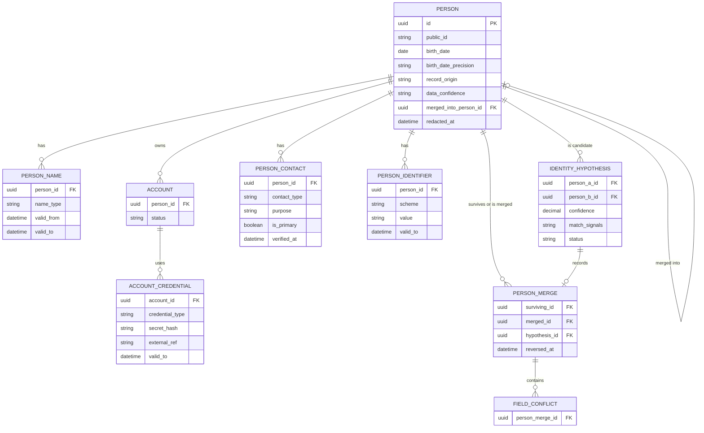
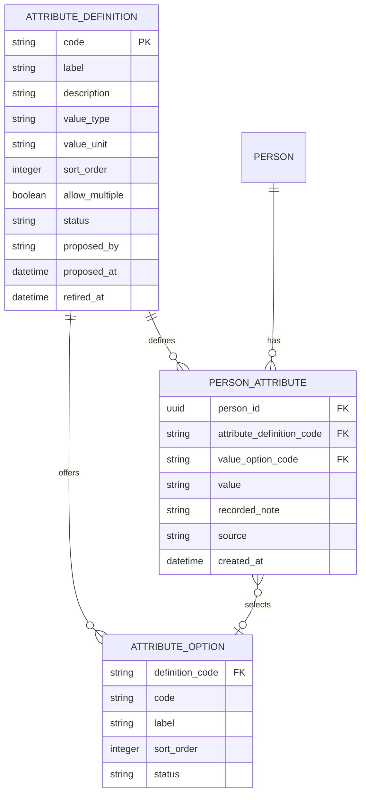
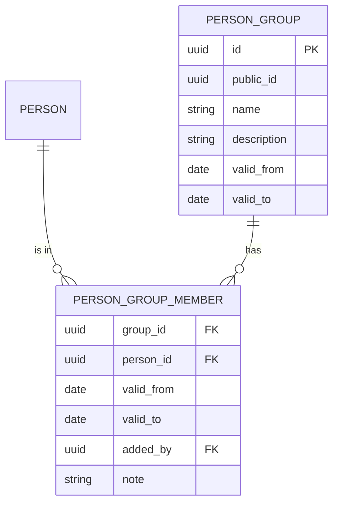
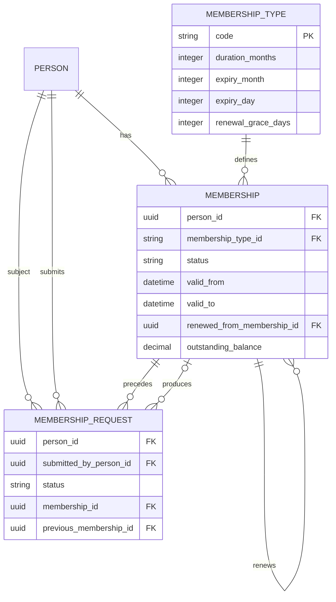
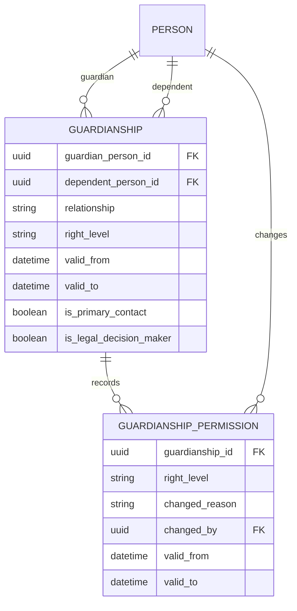

# Appendix — Entity Relationship Diagrams

This appendix describes **relationships** — what points at what, how many, and whether the
link is temporal. Field-level definitions live in the data-model documents, each in the one
that owns the entity, and are deliberately not repeated here.

Diagrams of the schema in [../data-model/00-conventions.md](../data-model/00-conventions.md).
Split by subject area so each
stays readable; the areas connect through `person`, which appears in all of them.

Notation: `→` is a foreign key pointing at the referenced table. `⇒` is a polymorphic
reference (no database-level foreign key). Temporal tables are marked `[T]`.

**Section numbers are shared across the three parts** and never renumbered, because other pages cite them by number and their anchors are built from them: [erd.md](erd.md) holds §1–§4, the diagrams of the people — identity and attributes, the unit's groups and offices, membership, guardianship; [erd-a-authorization.md](erd-a-authorization.md) holds §5–§5b, the whole authorization answer, its tables and the audience expression tree; [erd-b-inventory.md](erd-b-inventory.md) holds §6–§8, the temporal pattern, the table inventory and the foreign key summary.
---

## 1. Identity

**Key point:** everything hangs off `person`, and `person` itself holds only identity.
No status, no role, no membership — everything else the organization records about the human is
the descriptive layer drawn next. See
[../data-model/01-identity.md](../data-model/01-identity.md#1-the-central-claim).

---

## 1a. Personal attributes — everything that is not a name, a gender or an age

**Key point:** these three tables are the whole of what the system knows about a person beyond
name, gender and age. There is no health table beside them and no privileged corner inside them:
[D-083](../decisions/round-07-08.md#d-083--there-is-no-medical-record-personal-data-is-one-class-of-data)
removed the category and
[D-084](../decisions/round-07-08.md#d-084--descriptive-data-is-organization-defined-at-runtime)
put an organization-maintained vocabulary in its place. Reading is `person.view`, writing is
`person.edit`, and only the vocabulary needs a code of its own
([`attribute.define`](permission-catalog-a-codes.md#2-people-and-identity)). Fields and rules:
[../data-model/09-attributes.md](../data-model/09-attributes.md).

**None of the three is `[T]`, and the `no` beside them in §7 is a decision, not an omission.** A
`person_attribute` row is **the current belief, overwritten in place**, and `audit_log` holds the
sequence of beliefs, **values included for as long as the payload window lasts — 24 months, after
which the row is reduced and the values are gone**
([D-088](../decisions/round-07-08.md#d-088--the-accounting-skeleton-is-permanent-the-audit-trail-is-short))
— which is why the trail is guarded as person data is
([the permission catalog §8](permission-catalog-a-codes.md#8-audit-and-system)). This corpus gives periods to
things that are true *over an interval* — a membership, an address, an office held, a guardian's
authority — and a descriptive value is not one of
those: it is a statement made now about whatever it is about, with a timestamp on the assertion. A
`valid_from` here would ask a volunteer when an allergy began, which is a question the
organization is not competent to record and has no rule that could use
([D-085](../decisions/round-07-08.md#d-085--the-identity-machinery-stays-structured-the-boundary-is-rules-not-sensitivity)).
The cost is named rather than left out: the history of a value lives in the one control
[D-081](../decisions/round-06.md#d-081--rule-names-survive-the-deletion-of-their-mechanisms-a-renamed-rule-must-say-who-enforces-it-now)
calls the corpus's weakest, and §7 lists it as the accepted risk. It is also a deliberate
departure from `guardianship` two sections below, which keeps its current value *and* its history
in business tables — because authority is asked "what was it on that date?" as a routine part of
answering whether an act was permitted, and an allergy list is not.

The two vocabulary tables are non-temporal for a smaller reason of their own: a code leaves
service by **status**, not by a period, so a value recorded against a retired option keeps meaning
what it meant on the day it was chosen. Retiring therefore never touches a fact — only redacting a
person erases one ([../domain/08-person-data.md](../domain/08-person-data.md#5-forgetting)).

---

## 2. Organization

**There is no organization-structure diagram, because there is no organization structure.** There is one
unit, it is the organization, and it is a **scope** and not a row: `grant_scope_type` carries a code
`unit` with `is_item_scoped = false`, and a grant written at it has no `scope_id`
([D-097](../decisions/round-10a.md#d-097--there-are-no-sub-units-the-unit-is-a-scope-not-a-row)).
What this section drew until round 10 was a hierarchy of bodies with a vocabulary of types, rename
history, lineage edges, rosters and offices. Every one of those tables is deleted, not moved; the ledger
of what each took with it is
[../data-model/02-organization.md §5](../data-model/02-organization.md#5-what-this-page-held-before-round-10).
What is left for this section to draw is the group — a set of people, not a body.

**Key point:** a group is a named set of people with a lifetime, and that is the whole of it — no parent,
no type, no `code`, no path, no nesting rule, no rename history, no split or merger edge, no leadership,
no roles, no fee ([D-098](../decisions/round-10a.md#d-098--a-group-is-a-person_group-explicit-members-a-lifetime-and-no-authority)).
**The member row is dated**, so the roster answers "who was in `schuzka2026-1` on 14 March 2026" from its
own rows rather than from the audit trail, whose payloads expire after 24 months
([D-088](../decisions/round-07-08.md#d-088--the-accounting-skeleton-is-permanent-the-audit-trail-is-short)).
No two rows for one person and one group overlap, counted over **all** rows and half-open, so a person who
left in 2020 and came back in 2024 is two rows and never one row edited in place.

**Membership of a group confers nothing.** A set is not a grant; a group member is reached only because
some grant's expression says `GROUP(x)`
([D-005](../decisions/round-01a.md#d-005--permissions-are-grants-never-derived-from-identity)).
The group *is* an item in `grant_scope_type`, so a grant may be written **on** one — that edge is in
[§5a](erd-a-authorization.md#5a-authorization--the-tables), not here, because `access_grant` owns it and not this module.
The box is deliberately alone beside its roster: `name` is unique across `role` and `person_group`
together, but no constraint spans two tables, so that is a write-path rule and not a drawn edge
([D-101](../decisions/round-10b.md#d-101--an-audience-is-an-expression-over-named-sets-stored-as-a-tree)).

**Gone from this diagram, one line each, so that a reader hunting for a box finds the decision:**

- ~~`org_unit`~~, ~~`org_unit_type`~~, ~~`org_unit_type_rule`~~, ~~`org_unit_name`~~,
  ~~`org_unit_relationship`~~ — all deleted by
  [D-097](../decisions/round-10a.md#d-097--there-are-no-sub-units-the-unit-is-a-scope-not-a-row), with
  `path`, `depth`, the unit vocabulary, the nesting checks, the rename history and the lineage edges.
  **There is no unit table anywhere in this appendix.** The unit appears once, as the `unit` row of
  `grant_scope_type` ([§5a](erd-a-authorization.md#5a-authorization--the-tables)) — a lookup row naming a scope, not a body.
- ~~`unit_participation`~~ — deleted by D-097. `person_group_member` is the roster that outlived it and
  `membership` (§3) is membership of the unit; **the import owes participation rows to nothing**.
- ~~`position`~~, ~~`position_assignment`~~ — deleted by
  [D-100](../decisions/round-10a.md#d-100--a-role-is-an-office-and-a-group-is-company-two-tables-of-the-same-shape):
  with one unit there is no body to be a leader **of**. `is_leadership` and `max_holders` went with them;
  the office survives as `role` + `role_holder` ([§5a](erd-a-authorization.md#5a-authorization--the-tables)).
- ~~`org_unit_type.allows_minors`~~ — the flag was deleted by
  [D-095](../decisions/round-09.md#d-095--units-carry-no-restrictions-joining-one-is-somebody-elses-act)
  and the table that carried it by D-097. *Do not place a child where nobody is responsible* is now
  `person_group.member.manage` held by a named adult, and the system can no longer say which groups are
  for children — that loss is D-095's, restated in D-098.
- ~~`scope_exposure`~~ — deleted by D-097 with the direction-of-authority check and the nightly alert that
  was its only detector. [§5](erd-a-authorization.md#5-authorization--the-whole-answer-in-one-diagram) says what was lost with it.

See [../data-model/02-organization.md](../data-model/02-organization.md) and
[../domain/04-organization-structure.md](../domain/04-organization-structure.md); the scope itself is
[../domain/06-authorization-model.md §2](../domain/06-authorization-model.md#2-scopes--the-unit-and-the-item).

---

## 3. Membership

**Four points that matter:**

- `membership_request` has **two** person references:
  `person_id` (the child, who would become a member) and `submitted_by_person_id` (the
  parent, who applied). Collapsing them makes the audit trail false.
- **A request asks for membership of the unit and names nothing else.** `requested_unit_id` is deleted
  with the units
  ([D-097](../decisions/round-10a.md#d-097--there-are-no-sub-units-the-unit-is-a-scope-not-a-row),
  [D-098](../decisions/round-10a.md#d-098--a-group-is-a-person_group-explicit-members-a-lifetime-and-no-authority)),
  and there is therefore no edge from this diagram to any body: which group a new member lands in is a
  write on the group — one `person_group_member` row, §2 — and not a preference on the request. The
  ~~unit this request was aimed at~~ is withdrawn, not moved; the want behind the column is served by the
  free-text `notes` the row already carries.
- **Belonging lives in two shapes now, and neither is a membership.** `person_group_member` (§2) is a
  group's dated roster and is keyed on **person**, never on `membership` — the argument `unit_participation`
  made and [D-098](../decisions/round-10a.md#d-098--a-group-is-a-person_group-explicit-members-a-lifetime-and-no-authority)
  carried over: an imported roster or a 1998 camper has no membership row to point at, and inferring an
  open-ended one would sweep that person into `MEMBERS` today. The table that held it,
  ~~`unit_participation`~~, is deleted by
  [D-097](../decisions/round-10a.md#d-097--there-are-no-sub-units-the-unit-is-a-scope-not-a-row), along
  with the root participation row every membership used to owe. Field rules:
  [../data-model/03-membership.md](../data-model/03-membership.md#5-unit_participation--deleted-by-d-097).
- **`membership_type` exists with exactly one row**, and `category`, `min_age`, `max_age`
  and `requires_background_check` are all gone. Membership is ageless
  ([D-038](../decisions/round-02-03.md#d-038--membership-is-ageless)); age is read from
  `person.birth_date` where it matters, which is guardianship — positions carried the last stored
  eligibility rule and [D-100](../decisions/round-10a.md#d-100--a-role-is-an-office-and-a-group-is-company-two-tables-of-the-same-shape)
  deleted it, so age is nobody's check and membership never was one.

---

## 4. Guardianship

**Key point:** guardianship is a general graph — one guardian → many dependents, many
guardians → one dependent, and a person may be both. Authority is per `guardianship` row, and
since [D-074](../decisions/round-06.md#d-074--a-guardians-rights-are-none-view-or-write-nothing-more-granular)
that row carries one value — `none`, `view` or `write` — so a parent may write one child's
records and only read another's. See
[../data-model/04-relationships.md](../data-model/04-relationships.md).

---
